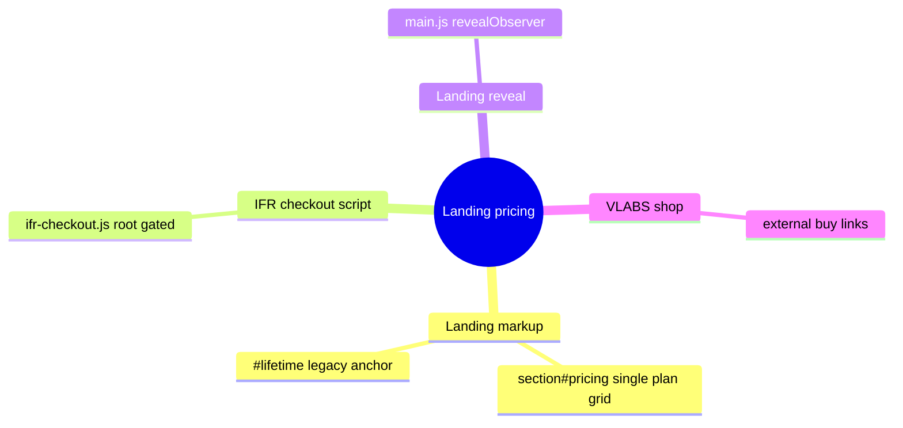

# Architecture map (narrow trace: landing pricing)

Scope: only the static landing -> lifetime offer / IFR holder section hop
(issue #208). Not a full repository map.

## 1. Core idea

- The static site presents SecureCall and sells paid editions as one-time
  lifetime licences through the VLABS shop (`website/index.html` `#pricing`,
  `docs/PRICING.md`).
- The Free edition stays €0 and links to the download section
  (`website/index.html` Free card -> `#download`).
- IFR holders get a planned browser-verified discount; verification and
  checkout are gated off (`data-ifr-enabled="false"`, `website/js/ifr-checkout.js`).

## 2. Trace

1. `website/index.html::nav a[href="#pricing"|"#lifetime"]` -> `website/index.html::section#pricing` (fragment; `#lifetime` is a legacy anchor on its section head)
2. `section#pricing::.pricing-grid` -> `https://vlabs.gr/en/shop?focus=security` (Pro/Premium Lifetime buy links)
3. `section#pricing::.pricing-grid` Free card -> `website/index.html::section#download` (`#download`)
4. `section#pricing::div#ifr[data-ifr-checkout]` -> `website/js/ifr-checkout.js::root` (DOM query; controls stay disabled)
5. `website/js/main.js::revealObserver` -> `.reveal` cards (visibility only)

## 3. Modules

| Module | Task | Entry | State |
| --- | --- | --- | --- |
| Landing markup | Render the single plan grid and IFR box | `website/index.html::section#pricing` | built |
| IFR checkout script | Bind wallet/discount controls to `#ifr` | `website/js/ifr-checkout.js::root` | built (gated) |
| Landing reveal | Animate `.reveal` elements | `website/js/main.js::revealObserver` | built |
| VLABS shop | External purchase and activation-code email | shop URL | external |
| Truth tests | Guard prices, links, single grid, anchors | `website/js/*.test.cjs` | built |

## 4. Wiring

- Navigation and sister pages (`./#pricing`, `./#lifetime`) land on the one pricing section.
- Paid lifetime cards hand off to the VLABS shop; no checkout runs on the page.
- The Free card hands off to the in-page download section.
- `ifr-checkout.js` finds `[data-ifr-checkout]` inside `#pricing`; its gates are unchanged.
- `main.js` only toggles visibility of `.reveal` cards.
- `landing.css` reserves desktop/mobile fixed-header clearance for direct `#lifetime` fragments; the landing stylesheet URL is versioned for cache refresh.

## 5. Contradictions and gaps

- Before #208 the paid offer rendered twice (`Access levels` grid and `Lifetime licences` grid). Resolved: one grid (Free, Pro Lifetime, Premium Lifetime).
- Open: IFR discount checkout stays disabled pending payment and fiscal approval.

## 6. Diagrams

- `docs/architecture/map.puml` (mindmap + components)
- `docs/architecture/main-path.puml` (sequence of the trace)

## 7. Next step

Module: Landing markup, hop 1-3, including fragment clearance in `website/css/landing.css`.
Untouched: `website/js/ifr-checkout.js`, `website/js/main.js`, sister pages.

---

# Narrow trace: Android heartbeat -> reconnect (issue #211)

Scope: only the existing staleness hop in
`client_android/app/src/main/java/com/securecall/app/net/HeartbeatClient.kt`.
`HeartbeatClient` owns all reconnect scheduling; `WebSocketService` only reacts.

## Trace

1. `startHeartbeat()::TimerTask.run` -> staleness check (`_lastSeen` older than 45s / 120s in call)
2. staleness -> `Handler(mainLooper).post` -> `state = DISCONNECTED`, `ws = null`, `oldWs.cancel()`, `listener.onDisconnected()`
3. same main-thread block -> `scheduleReconnect()` (guards: `isClosed`, `inRecoveryMode`, `reconnectPending`; backoff unchanged)
4. `scheduleReconnect()::postDelayed` -> `connect()` -> `okClient.newWebSocket`

## Gap resolved

- Before #211 hop 3 relied on `onFailure` from `oldWs.cancel()`; because `ws` was cleared
  first, the stale-socket guard (`webSocket !== ws`) dropped that callback and no reconnect was
  scheduled. Hop 3 now calls the existing `scheduleReconnect()` directly; the cancelled socket's
  `onFailure` stays ignored, so exactly one retry is queued.
- Untouched: `onClosing` 1000 policy, 4000..4099 hard stop, `close()`, flap recovery, backoff,
  TLS/pins, URLs. Guarded by `app/src/test/.../net/HeartbeatClientStaleReconnectTest.kt`.

---

# Narrow trace: Android policy stop -> warm resume (issue #220)

Scope: `SecureCallApplication`, `WebSocketService`, a read-only lifecycle accessor
in `HeartbeatClient`, and existing status wiring in `MainActivity`. No call,
foreground-service API, preference, authentication or reconnect-policy redesign.

| Module | Ownership | Hop |
| --- | --- | --- |
| Application lifecycle | Main-thread activity count, 15s stop and one-shot resume intent | activity stop -> policy stop -> service destruction -> foreground start |
| Signaling service | Own client teardown and instance-scoped offline publication | onDestroy -> client close -> Application completion |
| Heartbeat client | Read-only eligibility; all socket retries stay here | connected, not closed/recovering/retrying -> eligible snapshot before close |
| Main activity | Current service's status callbacks and bounded existing binding retries | onResume/offline -> rebind -> current-state refresh |

- Application remembers the exact service requested to stop, not an arbitrary absence.
  It waits for that instance's destruction before starting via its existing
  foreground-service startup path. A return before the delayed stop only cancels it.
- Eligibility is sampled immediately before intentional client close. Only an
  established CONNECTED client with no pending retry/recovery and no connection
  attempt in the existing 10s flap window is resumable. A
  disconnected/connecting client, manual close, auth400x or clean1000 is not.
  Interrupted retry/backoff/recovery is deliberately not reconstructed in a new client.
- Service destruction clears its own connection/registration state; only the current
  instance clears the singleton and publishes offline. A replacement is untouched.
- MainActivity detaches obsolete callbacks, checks instance ownership again on UI
  delivery, and refreshes an already-connected replacement without reconnecting it.
- Process-local only: cold startup/call startup, task removal, FCM, Android API35+
  background policy and preference defaults are unchanged. Device proof is separate.

---

# Narrow trace: German Google Play listing metadata (2026-11-16)

- Module: static Play listing metadata, not application runtime or direct-download offers.
- Source: `fastlane/metadata/android/en-US/{title,short_description,full_description}.txt`.
- Hop: accepted English listing meaning -> German
  `fastlane/metadata/android/de-DE/{title,short_description,full_description}.txt`
  -> manual transfer by the parent operator to the German Play Console listing.
- Gap: German listing text was missing locally; the parent reports stale public
  auto-translation and only an English Console locale. The new files supply an
  explicit translation, not an automated uploader or a Console acceptance receipt.
- Preserve the three public URLs, no Play-owned VPN, no WalletConnect/in-app IFR
  unlock, and unavailable paid controls pending separate release gates.
- Checks: exact five-file allowlist, strict UTF-8, Unicode character limits,
  URL parity, mandatory caveats, semantic review and `git diff --check`.
- Open: parent-owned Console language addition/manual transfer, Google review and
  public German listing verification. No language-tag or changelog edit here.
- Untouched: English metadata, all changelogs, app/runtime, permissions, screenshots,
  distribution matrix, offers and diagram files. No build or deployment.

---

# Narrow trace: SecureCall purchase category links (issue #226)

- Module: public landing purchase links and their download/help/template mirrors.
- Hop: `website/index.html::section#pricing` and existing SecureCall purchase
  references -> `https://vlabs.gr/{en|de|el}/shop?focus=security`.
- Only the category query changes; language, prices, licence scope, download
  destinations, Free/Play/direct distribution copy and IFR gates stay unchanged.
- README and `docs/WIKI` contain no affected category URL and remain untouched;
  the separate SecureChat/Chameleon FAQ purchase link is outside this task.
- Regression: `website/js/product-truth.test.cjs` checks all 26 static SecureCall
  purchase targets; existing template tests exercise both paid CTAs in en/de/el.
- Source suite: `node --test website/js/*.test.cjs` -> 61/61 PASS; the new category
  regression fails on the original links and passes after the URL-only correction.
- Open: parent-owned responsive browser checks and publication. No visual or
  checkout-readiness acceptance is asserted; application/runtime and diagrams
  remain unchanged.

---

# Narrow trace: signaling XML dependency lock (alert #38, 2026-11-16)

- Module: signaling optional XML dependency closure, not application code.
- Hop: `backend/signaling/package.json::firebase-admin` -> locked
  `firebase-admin@13.10.0::optionalDependencies[@google-cloud/storage]` ->
  `@google-cloud/storage@7.19.0::dependencies[fast-xml-parser]` (`^5.3.4`).
- The existing range permits `fast-xml-parser@5.12.0`, the first patched
  version for GHSA-474x-hrwr-fgx4 (affected `<=5.11.2`). The advisory concerns
  quadratic CPU consumption with non-default `stopNodes`; application-level
  exposure was not traced or tested in this lockfile-only task.
- Only `backend/signaling/package-lock.json` changes: parser 5.7.2 -> 5.12.0,
  five required XML support-package upgrades, and two required new support
  packages. All eight records match exact official npm version metadata.
- Direct policy, overrides, scripts, existing parent packages and every other
  lockfile record are preserved. No override, source or runtime-path change.
- Source checks: JSON/metadata/dependency-range/preservation assertions and
  `git diff --check` PASS. Full install, reproducer, tests, lint, build and CI
  NOT_RUN under host CPU HOLD; parent owns subsequent diff review and checks.
- This is an uncommitted source candidate, not runtime compatibility, alert
  closure or release acceptance. Diagram files remain unchanged.

---

# Narrow trace: ACTIVE signaling session lifecycle (2026-11-16)

- Module: signaling heartbeat and existing WS/call route ownership.
- Hop: `server.js::new HeartbeatManager(routingTable, clients, clientIds)` ->
  `heartbeat.js::start` -> shared `clients` / `routingTable` maps.
- Liveness: `ws/index.js::pong|message` -> `updateClient(connId)` updates
  `lastSeen`, not `session.updated`. `call.js::CALL_KEY_CONFIRM` enters ACTIVE;
  `webrtc.js::activeSession` subsequently requires that route to exist.
- Teardown: heartbeat timeout -> `ws.terminate()` -> asynchronous
  `ws/index.js::close` -> current `clientIds` owner check -> peer CALL_END,
  route deletion, binding deletion, IP decrement and rate-limit cleanup.
- Replacement: registration/contact handlers rebind `clientIds`; close of a
  superseded connection must not delete the replacement's route or binding.
- Red evidence: actual manager + dispatcher + call/WebRTC handlers, synthetic
  peers and bounded fake time in `heartbeat_lifecycle.test.js`: healthy ACTIVE
  disappears at 65s; delete-before-close loses teardown metadata; failed ping
  deletes a client without terminating its socket. Four of eight cases pass
  (pending expiry, current close, superseded close, explicit END/BUSY).
- Initial scope/design blocker: heartbeat had no authoritative `clientIds` reference.
  A safe ownership-aware fix needs the existing map passed at the server
  construction hop (one additional source file), not a second registry.
  The traced call handlers have no ACTIVE route-count/per-peer admission cap;
  the WS message limiter bounds rate, not lifetime accumulation. Keeping every
  ACTIVE route while both peers answer pings is not a bounded session policy.
- Initial next step: parent decides the bounded ACTIVE-retention/admission contract and
  authorizes the exact extra ownership wiring before implementation. No new
  timeout, transfer, registry or maintenance policy is selected here.
- Initial changes were test + this map only; heartbeat, package test chain, server,
  Android, security/protocol, limits and diagram files remain untouched.
  No green fix, full-suite, live call, media, drain or device proof is claimed.

## Parent-bounded extension (approved before feature edits)

- Ownership hop: `server.js` passes the existing `clientIds` map to the
  manager; ACTIVE lifetime follows both current participant records, including
  termination until WS close owns notification and metadata cleanup. Unowned
  ACTIVE and pending routes retain the existing 60s timestamp expiry.
- Admission hop: both `call.js::authenticatedInvite|legacyInvite` -> shared
  in-module admission check over `routingTable` -> existing forward/push/set.
  Before those side effects, reject at 10000 global routes or 32 originating
  routes (all states) with the existing `rate_limited` shape. Originator comes
  from trusted connection context, never `msg.from`; no recipient quota,
  eviction, second registry, config flag, tier or conversation-duration rule.
- Exact scope: heartbeat, one server constructor line, call admission, the
  lifecycle test, one capacity test, package test-chain wiring and this map.
  Parent owns full locked CI, exact-head security and release acceptance.

## Implemented candidate and focused evidence

- `HeartbeatManager` now resolves both ACTIVE participant IDs through the
  authoritative binding map and checks the current record's `clientId`.
  Open clients retain the existing idle deadlines; ping errors terminate.
  Non-open sockets and their metadata remain for real WS close cleanup.
- Both invite paths check current caller ownership and the shared admission
  bounds before forwarding, push or insertion. Denial never evicts routes;
  counts derive from the existing table, so END/BUSY, expiry and close release
  capacity without a separate counter. Recipient load does not consume the
  caller's quota, and a supplied `msg.from` cannot choose the charged identity.
- Before feature edits: lifecycle 5/11 PASS (healthy ACTIVE lost at 65s,
  termination metadata lost, failed-ping socket not terminated); capacity
  4/18 PASS (both protocols admitted beyond the intended ceilings).
- Before the transport extension, `npm run test:call-lifecycle` ran only the
  standard-Node tests: lifecycle 12/12 and capacity 20/20 PASS.
  This includes a 10-minute synthetic ACTIVE lifecycle with later WebRTC
  signaling, pending/orphan deadlines, one-peer timeout notification,
  superseded ownership, exact capacity boundaries, no-side-effect denials,
  both protocols and quota reuse after END/BUSY, expiry and close.
- The package pretest chain includes the focused chain. Full backend/Android,
  lint, secret CI and scoped security review remain parent-owned and NOT_RUN
  locally. No app server, install, network, device, provider or live call/media/
  drain test was performed; diagram files and WS close implementation are unchanged.

## Real-transport regression source (parent execution required)

- Eighth file: `src/__tests__/heartbeat_transport.test.js`, included in the
  same `test:call-lifecycle` / pretest chain. Production logic is unchanged.
- Hop: test-owned `127.0.0.1:0` HTTP/WSS -> real `ws` peers -> existing
  `ws/index.js::setup` + `HeartbeatManager` -> real terminate/close callbacks.
  Synthetic already-verified records and a test-owned limiter isolate stores,
  registration, providers, application startup and media from this test.
- Three source cases: current timeout cleanup + peer notification, injected
  ping failure + actual termination/close, superseded old-socket termination
  preserving the replacement binding and ACTIVE route without CALL_END.
- Fake interval capture and clock are synchronous and immediately restored.
  Each case has a 4s deadline, cleanup a 2s deadline, the suite a 20s deadline;
  finally terminates only owned peers, destroys owned TCP sockets, closes WSS/
  HTTP, clears timers and restores logging. Results contain fixed labels only.
- New transport test and expanded chain: NOT_RUN locally under host HOLD.
  Syntax/source checks are not transport acceptance. Executed 12+20 PASS
  remains separate; parent hosted locked npm-ci/full CI must run all cases
  and perform scoped exact-candidate security review before integration.
## Temporary Hosted Rust Controller (SC-STX24-RUST-HOSTED-20261117)

- Purpose: one parent-dispatched offline AEAD qualification; never merge this
  temporary controller into main. Public base b59f9742; private target 5222690f,
  tree fdf7e6cd495cf19db48f63dfa29e135daf212e97. No application changes.
- Planned hop: parent -> `sc-media-qualification.py::pack` reads exact Git blobs
  and explicitly selected public registry files -> deterministic private tar.
- Planned hop: `android-instrumentation.yml::rust-aead` -> trusted Python host
  validates dispatch/head/runner/resources and owned still-DRAFT release ->
  bounded download, pinned hashes, manual regular-file extraction.
- Planned hop: trusted host -> directory-only imported empty image -> Docker
  create -> exact inspect gate -> start one offline cargo command. Target sees
  readonly source/cache/toolchain/OS libraries, no host token/home/socket.
- Planned hop: bounded private pipe -> exact AEAD/media_v3 results -> fixed
  public booleans/counts; diagnostics only to the same still-DRAFT release.
- Cleanup: exact owned container cgroup and empty image, including on failure;
  no shared prune, build, artifact/cache upload, source publication or install.
- Metadata correction: 66 cached locked archives include six Windows-related
  archives; only the nine absent Windows packages are omitted. 73 sparse index
  files cover all 75 locked registry versions. Nothing is downloaded by PACK.
- Modules: workflow (manual admission), Python (trusted PACK/host/bootstrap),
  frozen `core_crypto` (unmodified, private input only). Implementation and real
  hosted acceptance are initially open; parent alone executes the latter.
- Diagrams: this narrow trace supersedes no existing diagram; no diagram edits.
- Next: implement this hop in the workflow/Python only. All media/application,
  dependency, normal branch, release policy and private handoff docs untouched.
- Owner-requested checkpoint: PACK source is saved but UNEXECUTED. `hosted`
  always refuses before token/network/Docker/target access. No sandbox is
  admitted. DRAFT transfer, validated extraction, create/inspect/start caps,
  capture/result verification and cleanup remain unimplemented. Workflow has
  read-only contents permission and no token injection until that gate exists.
- Parent continuation23:04UTC supersedes that checkpoint: hosted admission,
  transfer and cleanup implemented at7ebf8b87. Run43974736259 executed16Rust
  AEAD cases once, all8new media cases PASS. Exact owned container/image/DRAFT/
  remote ref cleaned; component receipt retained privately. NEVER MERGE this
  controller; no Android/JNI/call/full-release acceptance is implied.

## Temporary Node Adapter (SC-STX24-NODE-QUALIFICATION-20261117)

- Module: existing temporary trusted qualification controller; NEVER MERGE.
- Hop 1: parent -> `sc-media-qualification.py::pack`: exact private 5222690f
  signaling blobs/package/lock -> ws + ethers locked dependency closure ->
  exact integrity-selected npm content-v2 tarballs -> bounded deterministic tar.
- Hop 2: `android-instrumentation.yml::node-authenticated-call` -> existing
  host admission -> owned still-DRAFT release ID 447731929 -> verified input.
- Hop 3: existing empty-image CREATE/INSPECT/cgroup gates -> readonly cached
  Node22 toolchain/source/dependencies -> scratch-only state -> exactly
  `node /source/backend/signaling/src/__tests__/authenticated_call.test.js`.
- Hop 4: exit zero + exact final PASS line -> one-script boolean; bounded
  private diagnostic `node-authenticated-call.txt` to the same owned DRAFT.
- Existing no-network/nonroot/cgroup/ulimit/wall/output/owned cleanup profile
  is reused, not redesigned. No npm lifecycle, install, download or new mode.
- Gap: parent must review, PACK and execute once. Source/static checks do not
  establish authenticated-call, real transport, FCM, audio or release acceptance.
- Diagrams unchanged for this narrow adapter. Frozen Rust receipt, application,
  tests and all parent coordination/ops files remain untouched.
- Parent result23:45UTC: run43979656186SUCCESS, one actual pinned Node script
  exit0/finalPASS, inspected notOOM; owned DRAFT/ref removed, private receipt
  retained. Rust proof unchanged. Android/JNI/call/full-release gates stay open.

## JVM Source Admission HOLD (SC-STX24-JVM-QUALIFICATION-20261117)

- Module: existing temporary qualification helper/workflow, NEVER MERGE.
- Hop: `android-instrumentation.yml::android-client` -> helper `hosted` ->
  `jvm_admission`; local `pack` uses the same gate before any source/cache IO.
- Symptom: the requested normal Free/Premium build needs a credential-free
  source admission decision before the existing sandbox can be reused.
- Fixed source/tree: 5222690fb51cc49b68d25199c9d87a7a8ed0c9a0 /
  fdf7e6cd495cf19db48f63dfa29e135daf212e97, not the public controller checkout.
- Blocker: tracked `client_android/app/google-services.json` contains three
  nonempty Google-format API key entries, without recognized synthetic markers.
  SHA256: 04e7bfaf5f58a6a551cfc074d7984a5c390889f04d6699a01603fcd5d9ddcaaf.
  Key validity/restrictions are UNKNOWN; no online validation was performed.
- `client_android/app/build.gradle` applies Google Services unconditionally;
  only the prohibited `isolatedDeviceTest` path disables DebugGoogleServices.
  Silently dropping its tracked input is not an admitted unchanged build.
  Generated AGP task edges remain unverified, not claimed as proven here.
- Implemented disposition: fixed numeric/blocker receipt, then refusal before
  PACK, token/private input, cache restoration, image or target access. Workflow
  uses the requested JVM ref/job ID but read-only permission and no GH_TOKEN.
- Existing Node implementation below the gate is retained, unreachable, not a
  JVM adapter. No filtered Gradle invocation or new sandbox is claimed ready.
- Next: parent resolves whether this exact client configuration is admissible
  under the no-API-credentials boundary, or supplies an approved credential-free
  source contract. Only then implement source-table pinning, trusted public cache
  staging and the exact four-class/eight-report JVM hop in the existing profile.
- Diagrams unchanged; application/test/build source, previous proof/reports,
  parent metadata/cleanup and all unrelated files remain untouched.

### Authorized Fixture Continuation (Parent Decision 23:58UTC)

- The HOLD above is historical, superseded by the explicit synthetic provider
  seam. The observation was format-only, not a confirmed live-secret finding.
- Hop 1: fixed Git blobs -> 795-file path/SHA256 table (9,130,079 bytes), pinned
  digest `0d281d67749fad7022abeb9af405b83805e5ef67499015f4fb957c96a200ad9a`.
  Original Google config contents are excluded. PACK consults schema/packages
  only; a deterministic invalid provider fixture preserves the three public
  package names and resource fields. Fixture digest is independently pinned:
  `a466488db1f666da3f1b941ad4c389a6b7940d5c93662adf25f77fb781fd63c7`.
- Hop 2: public controller checkout -> pinned read-only setup-gradle cache
  restoration (no gradle-version/install, graph, scan or cache write). Only then
  the trusted host receives the private bundle from exact still-DRAFT ID 447762646.
  Host checks bundle, canonical source table, each file, fixture and source/tree.
- Hop 3: preinstalled JDK17/real SDK37 and required native configuration tools
  -> readonly component mounts. Exact wrapper ZIP SHA256 and public artifacts
  pinned in source verification-metadata.xml -> bounded isolated staging.
  Only modules-2/files-2.1 plus selected metadata-2.107 records are staged;
  no home, init, user properties, configuration cache, daemon or transform state.
  Missing essentials refuse admission before Docker import/CREATE/target.
- Hop 4: existing imported empty image -> CREATE -> exact INSPECT gate ->
  kernel cgroup/uid/NNP/capability checks -> disposable scratch project/Gradle
  home. Profile: network-none, readonly mounts/root, uid65534, capdrop/NNP,
  private cgroup, 1CPU/4GiB/no swap/256pids, 3GiB scratch, CPU840s,
  file512MiB/nofile1024, wall900s/output512KiB. Fixed /tmp symlink and synthetic
  passwd/group only. No actual provider config, credentials, source patches or skips.
- Hop 5: one normal offline project Gradle invocation, -Pinternal, exactly
  four --tests filters for each of FreeDebug and PremiumDebug. No plugin/policy
  bypass. Trusted receipt verifier checks exactly eight XML class reports and
  pinned method names/counts (11/4/2/5 each flavor), zero failures/errors/skips.
  Public output is fixed numeric/boolean receipts only; raw bounded diagnostics
  go only to the same revalidated still-DRAFT release. Exit0/notOOM required.
- Hop 6: exact owned container/image removal plus exact cgroup descendant-empty
  verification, repeated safely by workflow fallback; no shared prune/cleanup.
- Provenance: exact 522 code with declared synthetic provider configuration,
  NOT production-config, FCM, JNI/native/device/call/customer-artifact acceptance.
- Static-only checkpoint: no PACK/import/target/CI run here. Actual hosted cache
  contents/tool availability, generated AGP graph, scratch fit, full compile and
  eight reports remain parent real-run gates. Prior Rust/Node receipts unchanged.
- Primary cache contracts: pinned setup-gradle action.yml/docs from the brief;
  https://docs.gradle.org/current/userguide/dependency_caching.html#sub:shared-readonly-cache

### Actual Host Admission Correction 2026-11-17T00:31Z

- Run43987695480 stopped before input download/image/target at the controller's
  obsolete android-37 path assumption. Official runner20261111.196 has stable
  android-37.0; both package.xml/API37.0 and empty codename are now checked.
  Actual SDK directory is mounted unchanged; no fake alias, app SDK edit or task skip.
- Runner metadata also confirms requested NDK27.0.12077973/CMake3.22.1 are not
  preinstalled. Reuse the normal CI's exact official sdkmanager packages, bounded
  360seconds on the disposable host BEFORE private input arrives. No paid runner,
  target egress, credentials, SDK update-all or alteration of shared resources.
- Rust/Node unchanged. This is a concrete changed admission, not a repeated JVM
  test: no Gradle/target invocation has occurred yet. Primary vendor metadata:
  https://raw.githubusercontent.com/actions/runner-images/ubuntu26/20261111.196/images/ubuntu/Ubuntu2604-Readme.md

- Second admission43988072867: real JDK17/SDK37.0/native tools PASS, private
  source input validated; missing cached raw Gradle ZIP before image/target.
  The restored wrapper cache entry is not proof that the original ZIP exists.
  Trusted host now stages only the source-pinned official9.8.0-all distribution
  over HTTPS, 180seconds/256MiB and exact SHA256, before private input; target
  remains offline with readonly archive and no automatic dependency installs.
  No app test has run. Third changed-admission continuation is bounded; on
  another failure stop this qualification series, retain the concrete blocker.

### Proven Cache-Path Controller Defect 2026-11-17T00:55Z

- Distinct read-only metadata run43990818862/95060a48SUCCESS, no app/Gradle/
  dependency execution or private inputs. All701 examined artifacts match the
  fixed source SHA256 policy. All37 old path-shape rejections are matching compact
  SHA1 directory names with leading zeroes omitted, not content mismatches.
- stage_cache now computes source SHA256 and directory SHA1 from the same stream.
  Source SHA256 authorization is unchanged; directory identity accepts only the
  computed full or compact SHA1, stricter than the old generic40-64hex shape.
  No dependency/policy pin change, bad-cache exception or SHA1 authorization.
- Remote metadata-only ref removed/absence404 verified; receipt retained privately.
  Existing JVM series remainsSTOPPED/NOT_RUN; no fourth qualification dispatched.

### Owner-Resumed Consolidated Qualification 2026-11-17

- Explicit owner answer resumes only5classes/62Free+Premium cases on frozen
  source6ba8fddd/tree129d. Root-cause cache correction retained, SHA256 policy
  never bypassed; official Gradle cache table confirms metadata-2.107 for8.11+.
- Fresh owned STILL-DRAFT448233448 and temp/sc-media-audio-jvm-20261117 bind
  the private synthetic-config payload. No reused failed-run assets or bindings.
- Existing enforced offline/nonroot/readonly/cgroup/caps/scratch profile and
  positive exact JUnit receipt checks unchanged. No Rust/backend/emulator rerun.
- No personal-device install, production config, provider/payment or release.
  https://docs.gradle.org/current/userguide/dependency_caching.html

### Changed Accept-Once Qualification 2026-11-17

- Parent accepted the previous 62-case run; it must not be repeated here.
- Exact new source354913fb/tree8e46783f contains the reviewed call-accept
  ownership delta. Select only CallAcceptOnceTest,8cases per Free/Premium.
- Fixed797-file table/SHA256 and unchanged synthetic provider fixture;
  original provider values stay excluded. Fresh STILL-DRAFT448305721 and
  temp/sc-accept-jvm-20261117 bind this input, never customer release assets.
- Existing trusted cache authentication, offline/nonroot/readonly/cgroup/
  CPU/memory/output/deadline limits and exact positive XML receipt checks
  remain unchanged. No emulator, native-device/call/finance/deploy acceptance.
- Parent source review done; actual compilation/test/owned cleanup NOT_RUN
  until this exact new controller receives an admitted single execution.

### JNI/ART Controller R1 BLOCKED (SC-JNI-ART-CONTROLLER-20261117)

- Module/hop: existing TEMP controller Hop A (`stage_cache` -> offline Gradle)
  before composing `assembleFreeDebug assembleFreeDebugAndroidTest` on d1eefa87.
- R1 pin coverage PASS (metadata-only, no Gradle/network): the androidTest
  closure of runner/rules1.7.0, ext-junit1.3.0, espresso-core3.7.0 walks 28
  modules from local public .module/.pom files; zero missing from d1eefa87
  verification-metadata.xml. aapt2 9.4.1 linux and prefab cli2.1.0 are pinned.
- R1 hosted cache coverage NOT PROVABLE and likely absent: every accepted run
  executed only `test*DebugUnitTest`, which never resolves androidTest
  configurations (11 androidTest-only modules, e.g. test:runner/monitor/
  services:storage/espresso). Main never ran an androidTest task, never used
  setup-gradle, and pins AGP8.11.1/androidx.test1.5.x, not d1eefa87's 1.7.0.
  The existing direct-coordinate check also skips androidTestImplementation.
- Safe staging unavailable in existing hops: Gradle's read-only cache needs
  Gradle-written metadata-2.107 records, so SHA-pinned raw downloads do not fit.
  A file repository or init script would change app source or the no-init profile.
- Disposition: BLOCKED before implementation. No controller/workflow change,
  no pack, no dispatch. Steps 2-4 (source pack d1eefa87, awk alias, APK export,
  API24 run) wait for a parent decision on one new public pre-input hop.
- Required admission (parent): one trusted, public, pre-private-input
  dependency warm-up, e.g. resolving only the pinned androidTest/prefab closure
  under strict verification-metadata into a fresh RUNNER_TEMP Gradle home,
  then `stage_cache` from it plus the restored cache. This is a new
  network+Gradle hop and a cache expansion; it is not in the admitted hops.
- Diagrams unchanged; application/build source and other paths untouched.

### JNI/ART Native Source Continuation (SC-JNI-ART-NATIVE-20261117)

1. **Purpose and boundary:** TEMP controller only, NEVER MERGE. Compose the
   admitted public preparation, offline Free APK build and eight headless JNI
   cases. No application, Rust build, UI241/focus/API36 or release work.
2. **Trace:** `hosted::dispatch_guard -> public_preparation -> stage_cache ->
   run_container(public=True) -> stage_cache(host recheck) -> extract_input ->
   trusted_strip_proof -> run_container(public=False, lineage=proof) ->
   run_headless -> draft receipt upload`.
3. **Modules:**

   | Module | Entry | Source status |
   | --- | --- | --- |
   | TEMP public preparation/offline build | `sc-media-qualification.py::hosted` | implemented, NOT_RUN |
   | Headless API24 runner | `sc-art-headless.sh::sc_art_main` | implemented, NOT_RUN |
   | Manual public hosted dispatch | `android-instrumentation.yml` | NOT_READY, disabled ref |

4. **Wiring:** Public phase runs only a controller-authored plugin-free Gradle
   project: runner/rules1.7.0, ext-junit1.3.0, espresso-core3.7.0 (transitive),
   prefab cli2.1.0-all and aapt2 9.4.1-15978811-linux (non-transitive).
   Read-only host fetch pins the original d1eefa87 verification XML SHA256
   `51e401f56ef9e68cf1fa279b731fc7b94d1404fbd4d1d7a31a5ec46b3965c4f5`.
   No repository wrapper, build script or application code runs with network.
   Generated public nsswitch uses `hosts: files dns`; private stays files-only,
   with its empty resolver/network-none unchanged. No new mount or TLS exception.
   Sanitized SHA256-verified restored artifacts seed a fresh tmpfs Gradle home;
   Gradle generates metadata-2.107. Only checksum-selected files and the
   original metadata allowlist are exported and rechecked before private input.
   No init scripts, verification-rule changes, cache blanket copy or paid storage.
   Public bridge networking ends before private input; the private build remains
   `--offline`/network-none, non-root, read-only/capdrop/NNP, 1CPU/4GiB/no swap,
   256pids, 3GiB scratch, CPU840/wall900, file512MiB/output512KiB.
   There is no RW host export mount: the owned container idles after checksum
   selection; host captures a bounded tar from its existing tmpfs, verifies it,
   then releases the hold and checks exit/cleanup. Private capture <=129MiB,
   two APKs <=64MiB each; public selected-cache capture <=1056MiB with <=1GiB
   expanded bytes and the original per-file/count limits. Both are deleted.
   The single public-resolved read-only `/etc/alternatives/awk` file alias is
   included in CREATE/INSPECT and the kernel mount allowlist, not its directory.
   Exact d1eefa87/tree2bf04aa2 pack: independently counted799 code files,
   root export guard, three existing .so pins and unchanged synthetic provider.
   Source-table SHA256:
   `66e57da8cc2b24e4d6a56354b52ec870299332a3562149947358baa2df7f13f9`.
   Build only `assembleFreeDebug assembleFreeDebugAndroidTest`, no `-Pinternal`.
   Export only the x86_64 split APK and test APK, <=64MiB each; compare both
   SHA256 receipts on host and the app's embedded x86_64 JNI digest. If the test
   APK embeds that JNI library, it must match too; absence there is expected.
   Headless launch uses an owned transient **user scope**, not a new service,
   no sudo/fallback. A fresh clean-env HOME/AVD/dedicated ADB port, API24 x86_64,
   cgroup1CPU/4GiB/no swap/256pids and CPU840/file512MiB/output512KiB/wall900
   are mandatory. Kernel limits are checked before emulator launch.
   Only isolation/shutdown primitives from23718a78 are copied verbatim; their
   legacy receipt labels are preserved, not the stopped visual runner. API24
   is checked before isolation; both OUTPUT DROP policies/probe witness precede
   install and remain held through guest shutdown. One exact JNI class only;
   parser requires eight distinct paired starts/successes, zero skips/errors,
   exact `OK (8 tests)` and one successful terminal instrumentation code.
   Host publishes only capped synthetic JSON to a fresh bound STILL-DRAFT.
   No APK/raw log/Actions artifact retention. Owned containers/image/cgroups,
   scope, emulator/ADB and temporary files are cleaned; kernel scope path is
   recorded for empty/absent verification even after unit collection.
5. **Gaps:** All runtime NOT_RUN. **Packaging lineage prerequisite:** source
   app/build.gradle has no keepDebugSymbols/doNotStrip/jniDebuggable declaration.
   Installed AGP9.4.1 JAR SHA256 matches the source verification pin:
   `4021fa6ea76b6fac076dd0bdacbb3e1b76c31f33b6c392e1a49a2e42072196bf`.
   Static `javap -c -p` only (no AGP/Gradle execution) shows
   `AbstractAppTaskManager` registers `StripDebugSymbolsTask$CreationAction`;
   the action maps MERGED_NATIVE_LIBS to STRIPPED_NATIVE_LIBS and the task's keep
   set comes from `doNotStrip union jniLibs.keepDebugSymbols`. The delegate
   sets justCopyInput only on keep-pattern match; the runnable otherwise invokes
   the selected strip executable with `--strip-unneeded -o output input`
   (fallback copying on absent/failed tool does not prove identity in advance).
   Thus FreeDebug has a strip path, not a guaranteed byte-preserving debug path.
   Parent now authorizes one exact transform based on its retained metadata-only
   Darwin NDK27 receipt: raw x86_64 SHA256
   `4a932002caab2e585f56950f5ea35d587d4f13b588c62549f5ad513eaf207c59`
   (618624 bytes) -> `--strip-unneeded` -> SHA256
   `abc5e77e3f17c7137ef94700266d7969643dc6f8f4a48f6097ca53befcd8d0ff`
   (477088 bytes), seven JNI exports unchanged per parent (not rerun here).
   After fully verified input arrives, before private application code, trusted
   host `trusted_strip_proof` uses only the mounted/pinned NDK27.0.12077973 Linux
   llvm-strip, on an owned bounded copy, with clean token-free environment,
   CPU30/wall30/file512KiB/output512KiB. Exact output must reproduce the parent
   hash AND size. Receipt records actual tool SHA256 (never guessed), resolved
   public tool path/size, NDK revision, flags/argv, input/output and bounds.
   The former unresolved-strip hard refusal is replaced by mandatory proof
   validation before any private container operation. Both APK checks accept
   ONLY those exact raw/stripped hash+size pairs, labeling the encoding; test
   APK JNI absence is unchanged. No app/Gradle config, source pin, private cap,
   export mount or other admission guard changes. Linux reproduction remains
   NOT_RUN and must succeed before app execution; no identity bypass/fallback.
   Hosted cache contents, standalone variant
   selection/repository-id compatibility, usable JDK CA store, scratch capacity,
   exact APK names/sizes, emulator/image revisions, existing non-root KVM access
   and user-manager delegation
   remain unproven. Missing user cgroup admission is a hard refusal, never sudo,
   another launcher or weaker limits. No offline/ART/native-device PASS claim.
6. **Diagrams:** Existing diagram paths are unchanged; only this admitted TEMP
   controller trace is extended. No application architecture change.
7. **Next:** Parent independently reviews this continuation atop dc56369b;
   Linux transform proof is mandatory during any admitted run. Parent adopts
   the user-scope runtime, pins immutable controller/ref/draft/input SHA plus
   emulator/image revisions, then admits any execution. ADMISSION/ref/draft and
   revision bindings remain NOT_READY. All application/other worker paths stay
   untouched; parent exclusively owns app d1eefa87 and execution/review.

### Append-Only R1 Baseline Correction (Parent-Verified 2026-11-17)

- The earlier R1 statements about "main never used setup-gradle/AndroidTest"
  and AGP8.11.1 came from stale local main `e9a36ad4`, not current remote main.
  They must not be used as current-source evidence or proof of cache absence.
- Parent reverified authoritative remote main `b59f9742`: Android root build
  already uses AGP9.4.1/Kotlin2.4.20; `ci-basic.yml` already uses setup-gradle
  and builds Free Debug/Release APK+AAB; `android-instrumentation.yml` already
  runs AndroidTest API24/36. These are parent-provided current facts; this
  source-only worker did not fetch/query the remote or execute those workflows.
- R1's actual result remains: hosted AndroidTest dependency/cache/metadata
  contents UNKNOWN, not proven absent or "likely absent" from stale main.
  The accepted metadata pin inspection is distinct from runtime cache coverage.
  Deterministic public pre-input strict preparation remains valid; no design,
  app/controller scope, stopped-series admission or runtime acceptance changes.

### CI KVM Prerequisite Adoption (2026-11-17)

- Actual metadata-only44066116615 stopped at `existing_user_kvm_access`;
  user-manager admission passed. No SDK download, private input or app run.
- Standard main already provisions CI KVM access via udev. This TEMP job uses
  a narrower ACL for only the existing runner UID on exactly `/dev/kvm`.
  Original ACL/inode recorded, same inode checked and original ACL restored
  in an always-step. No world-access rule, new service or weaker launcher.
- This adoption is confined to the GitHub-hosted job, never Mac/production/
  Guardian/other projects. Private container still has no device mappings,
  capabilities or network; non-root headless/user-scope guards unchanged.
