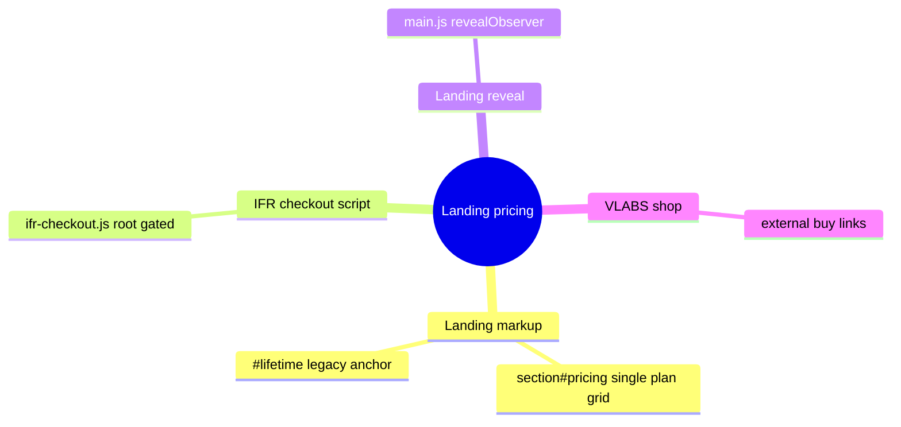

# Architecture map (narrow trace: landing pricing)

Scope: only the static landing -> lifetime offer / IFR holder section hop
(issue #208). Not a full repository map.

## 1. Core idea

- The static site presents SecureCall and sells paid editions as one-time
  lifetime licences through the VLABS shop (`website/index.html` `#pricing`,
  `docs/PRICING.md`).
- The Free edition stays €0 and links to the download section
  (`website/index.html` Free card -> `#download`).
- IFR holders get a planned browser-verified discount; verification and
  checkout are gated off (`data-ifr-enabled="false"`, `website/js/ifr-checkout.js`).

## 2. Trace

1. `website/index.html::nav a[href="#pricing"|"#lifetime"]` -> `website/index.html::section#pricing` (fragment; `#lifetime` is a legacy anchor on its section head)
2. `section#pricing::.pricing-grid` -> `https://vlabs.gr/en/shop?focus=security` (Pro/Premium Lifetime buy links)
3. `section#pricing::.pricing-grid` Free card -> `website/index.html::section#download` (`#download`)
4. `section#pricing::div#ifr[data-ifr-checkout]` -> `website/js/ifr-checkout.js::root` (DOM query; controls stay disabled)
5. `website/js/main.js::revealObserver` -> `.reveal` cards (visibility only)

## 3. Modules

| Module | Task | Entry | State |
| --- | --- | --- | --- |
| Landing markup | Render the single plan grid and IFR box | `website/index.html::section#pricing` | built |
| IFR checkout script | Bind wallet/discount controls to `#ifr` | `website/js/ifr-checkout.js::root` | built (gated) |
| Landing reveal | Animate `.reveal` elements | `website/js/main.js::revealObserver` | built |
| VLABS shop | External purchase and activation-code email | shop URL | external |
| Truth tests | Guard prices, links, single grid, anchors | `website/js/*.test.cjs` | built |

## 4. Wiring

- Navigation and sister pages (`./#pricing`, `./#lifetime`) land on the one pricing section.
- Paid lifetime cards hand off to the VLABS shop; no checkout runs on the page.
- The Free card hands off to the in-page download section.
- `ifr-checkout.js` finds `[data-ifr-checkout]` inside `#pricing`; its gates are unchanged.
- `main.js` only toggles visibility of `.reveal` cards.
- `landing.css` reserves desktop/mobile fixed-header clearance for direct `#lifetime` fragments; the landing stylesheet URL is versioned for cache refresh.

## 5. Contradictions and gaps

- Before #208 the paid offer rendered twice (`Access levels` grid and `Lifetime licences` grid). Resolved: one grid (Free, Pro Lifetime, Premium Lifetime).
- Open: IFR discount checkout stays disabled pending payment and fiscal approval.

## 6. Diagrams

- `docs/architecture/map.puml` (mindmap + components)
- `docs/architecture/main-path.puml` (sequence of the trace)

## 7. Next step

Module: Landing markup, hop 1-3, including fragment clearance in `website/css/landing.css`.
Untouched: `website/js/ifr-checkout.js`, `website/js/main.js`, sister pages.

---

# Narrow trace: Android heartbeat -> reconnect (issue #211)

Scope: only the existing staleness hop in
`client_android/app/src/main/java/com/securecall/app/net/HeartbeatClient.kt`.
`HeartbeatClient` owns all reconnect scheduling; `WebSocketService` only reacts.

## Trace

1. `startHeartbeat()::TimerTask.run` -> staleness check (`_lastSeen` older than 45s / 120s in call)
2. staleness -> `Handler(mainLooper).post` -> `state = DISCONNECTED`, `ws = null`, `oldWs.cancel()`, `listener.onDisconnected()`
3. same main-thread block -> `scheduleReconnect()` (guards: `isClosed`, `inRecoveryMode`, `reconnectPending`; backoff unchanged)
4. `scheduleReconnect()::postDelayed` -> `connect()` -> `okClient.newWebSocket`

## Gap resolved

- Before #211 hop 3 relied on `onFailure` from `oldWs.cancel()`; because `ws` was cleared
  first, the stale-socket guard (`webSocket !== ws`) dropped that callback and no reconnect was
  scheduled. Hop 3 now calls the existing `scheduleReconnect()` directly; the cancelled socket's
  `onFailure` stays ignored, so exactly one retry is queued.
- Untouched: `onClosing` 1000 policy, 4000..4099 hard stop, `close()`, flap recovery, backoff,
  TLS/pins, URLs. Guarded by `app/src/test/.../net/HeartbeatClientStaleReconnectTest.kt`.

---

# Narrow trace: Android policy stop -> warm resume (issue #220)

Scope: `SecureCallApplication`, `WebSocketService`, a read-only lifecycle accessor
in `HeartbeatClient`, and existing status wiring in `MainActivity`. No call,
foreground-service API, preference, authentication or reconnect-policy redesign.

| Module | Ownership | Hop |
| --- | --- | --- |
| Application lifecycle | Main-thread activity count, 15s stop and one-shot resume intent | activity stop -> policy stop -> service destruction -> foreground start |
| Signaling service | Own client teardown and instance-scoped offline publication | onDestroy -> client close -> Application completion |
| Heartbeat client | Read-only eligibility; all socket retries stay here | connected, not closed/recovering/retrying -> eligible snapshot before close |
| Main activity | Current service's status callbacks and bounded existing binding retries | onResume/offline -> rebind -> current-state refresh |

- Application remembers the exact service requested to stop, not an arbitrary absence.
  It waits for that instance's destruction before starting via its existing
  foreground-service startup path. A return before the delayed stop only cancels it.
- Eligibility is sampled immediately before intentional client close. Only an
  established CONNECTED client with no pending retry/recovery and no connection
  attempt in the existing 10s flap window is resumable. A
  disconnected/connecting client, manual close, auth400x or clean1000 is not.
  Interrupted retry/backoff/recovery is deliberately not reconstructed in a new client.
- Service destruction clears its own connection/registration state; only the current
  instance clears the singleton and publishes offline. A replacement is untouched.
- MainActivity detaches obsolete callbacks, checks instance ownership again on UI
  delivery, and refreshes an already-connected replacement without reconnecting it.
- Process-local only: cold startup/call startup, task removal, FCM, Android API35+
  background policy and preference defaults are unchanged. Device proof is separate.

---

# Narrow trace: German Google Play listing metadata (2026-11-16)

- Module: static Play listing metadata, not application runtime or direct-download offers.
- Source: `fastlane/metadata/android/en-US/{title,short_description,full_description}.txt`.
- Hop: accepted English listing meaning -> German
  `fastlane/metadata/android/de-DE/{title,short_description,full_description}.txt`
  -> manual transfer by the parent operator to the German Play Console listing.
- Gap: German listing text was missing locally; the parent reports stale public
  auto-translation and only an English Console locale. The new files supply an
  explicit translation, not an automated uploader or a Console acceptance receipt.
- Preserve the three public URLs, no Play-owned VPN, no WalletConnect/in-app IFR
  unlock, and unavailable paid controls pending separate release gates.
- Checks: exact five-file allowlist, strict UTF-8, Unicode character limits,
  URL parity, mandatory caveats, semantic review and `git diff --check`.
- Open: parent-owned Console language addition/manual transfer, Google review and
  public German listing verification. No language-tag or changelog edit here.
- Untouched: English metadata, all changelogs, app/runtime, permissions, screenshots,
  distribution matrix, offers and diagram files. No build or deployment.

---

# Narrow trace: SecureCall purchase category links (issue #226)

- Module: public landing purchase links and their download/help/template mirrors.
- Hop: `website/index.html::section#pricing` and existing SecureCall purchase
  references -> `https://vlabs.gr/{en|de|el}/shop?focus=security`.
- Only the category query changes; language, prices, licence scope, download
  destinations, Free/Play/direct distribution copy and IFR gates stay unchanged.
- README and `docs/WIKI` contain no affected category URL and remain untouched;
  the separate SecureChat/Chameleon FAQ purchase link is outside this task.
- Regression: `website/js/product-truth.test.cjs` checks all 26 static SecureCall
  purchase targets; existing template tests exercise both paid CTAs in en/de/el.
- Source suite: `node --test website/js/*.test.cjs` -> 61/61 PASS; the new category
  regression fails on the original links and passes after the URL-only correction.
- Open: parent-owned responsive browser checks and publication. No visual or
  checkout-readiness acceptance is asserted; application/runtime and diagrams
  remain unchanged.

---

# Narrow trace: signaling XML dependency lock (alert #38, 2026-11-16)

- Module: signaling optional XML dependency closure, not application code.
- Hop: `backend/signaling/package.json::firebase-admin` -> locked
  `firebase-admin@13.10.0::optionalDependencies[@google-cloud/storage]` ->
  `@google-cloud/storage@7.19.0::dependencies[fast-xml-parser]` (`^5.3.4`).
- The existing range permits `fast-xml-parser@5.12.0`, the first patched
  version for GHSA-474x-hrwr-fgx4 (affected `<=5.11.2`). The advisory concerns
  quadratic CPU consumption with non-default `stopNodes`; application-level
  exposure was not traced or tested in this lockfile-only task.
- Only `backend/signaling/package-lock.json` changes: parser 5.7.2 -> 5.12.0,
  five required XML support-package upgrades, and two required new support
  packages. All eight records match exact official npm version metadata.
- Direct policy, overrides, scripts, existing parent packages and every other
  lockfile record are preserved. No override, source or runtime-path change.
- Source checks: JSON/metadata/dependency-range/preservation assertions and
  `git diff --check` PASS. Full install, reproducer, tests, lint, build and CI
  NOT_RUN under host CPU HOLD; parent owns subsequent diff review and checks.
- This is an uncommitted source candidate, not runtime compatibility, alert
  closure or release acceptance. Diagram files remain unchanged.

---

# Narrow trace: ACTIVE signaling session lifecycle (2026-11-16)

- Module: signaling heartbeat and existing WS/call route ownership.
- Hop: `server.js::new HeartbeatManager(routingTable, clients, clientIds)` ->
  `heartbeat.js::start` -> shared `clients` / `routingTable` maps.
- Liveness: `ws/index.js::pong|message` -> `updateClient(connId)` updates
  `lastSeen`, not `session.updated`. `call.js::CALL_KEY_CONFIRM` enters ACTIVE;
  `webrtc.js::activeSession` subsequently requires that route to exist.
- Teardown: heartbeat timeout -> `ws.terminate()` -> asynchronous
  `ws/index.js::close` -> current `clientIds` owner check -> peer CALL_END,
  route deletion, binding deletion, IP decrement and rate-limit cleanup.
- Replacement: registration/contact handlers rebind `clientIds`; close of a
  superseded connection must not delete the replacement's route or binding.
- Red evidence: actual manager + dispatcher + call/WebRTC handlers, synthetic
  peers and bounded fake time in `heartbeat_lifecycle.test.js`: healthy ACTIVE
  disappears at 65s; delete-before-close loses teardown metadata; failed ping
  deletes a client without terminating its socket. Four of eight cases pass
  (pending expiry, current close, superseded close, explicit END/BUSY).
- Initial scope/design blocker: heartbeat had no authoritative `clientIds` reference.
  A safe ownership-aware fix needs the existing map passed at the server
  construction hop (one additional source file), not a second registry.
  The traced call handlers have no ACTIVE route-count/per-peer admission cap;
  the WS message limiter bounds rate, not lifetime accumulation. Keeping every
  ACTIVE route while both peers answer pings is not a bounded session policy.
- Initial next step: parent decides the bounded ACTIVE-retention/admission contract and
  authorizes the exact extra ownership wiring before implementation. No new
  timeout, transfer, registry or maintenance policy is selected here.
- Initial changes were test + this map only; heartbeat, package test chain, server,
  Android, security/protocol, limits and diagram files remain untouched.
  No green fix, full-suite, live call, media, drain or device proof is claimed.

## Parent-bounded extension (approved before feature edits)

- Ownership hop: `server.js` passes the existing `clientIds` map to the
  manager; ACTIVE lifetime follows both current participant records, including
  termination until WS close owns notification and metadata cleanup. Unowned
  ACTIVE and pending routes retain the existing 60s timestamp expiry.
- Admission hop: both `call.js::authenticatedInvite|legacyInvite` -> shared
  in-module admission check over `routingTable` -> existing forward/push/set.
  Before those side effects, reject at 10000 global routes or 32 originating
  routes (all states) with the existing `rate_limited` shape. Originator comes
  from trusted connection context, never `msg.from`; no recipient quota,
  eviction, second registry, config flag, tier or conversation-duration rule.
- Exact scope: heartbeat, one server constructor line, call admission, the
  lifecycle test, one capacity test, package test-chain wiring and this map.
  Parent owns full locked CI, exact-head security and release acceptance.

## Implemented candidate and focused evidence

- `HeartbeatManager` now resolves both ACTIVE participant IDs through the
  authoritative binding map and checks the current record's `clientId`.
  Open clients retain the existing idle deadlines; ping errors terminate.
  Non-open sockets and their metadata remain for real WS close cleanup.
- Both invite paths check current caller ownership and the shared admission
  bounds before forwarding, push or insertion. Denial never evicts routes;
  counts derive from the existing table, so END/BUSY, expiry and close release
  capacity without a separate counter. Recipient load does not consume the
  caller's quota, and a supplied `msg.from` cannot choose the charged identity.
- Before feature edits: lifecycle 5/11 PASS (healthy ACTIVE lost at 65s,
  termination metadata lost, failed-ping socket not terminated); capacity
  4/18 PASS (both protocols admitted beyond the intended ceilings).
- Before the transport extension, `npm run test:call-lifecycle` ran only the
  standard-Node tests: lifecycle 12/12 and capacity 20/20 PASS.
  This includes a 10-minute synthetic ACTIVE lifecycle with later WebRTC
  signaling, pending/orphan deadlines, one-peer timeout notification,
  superseded ownership, exact capacity boundaries, no-side-effect denials,
  both protocols and quota reuse after END/BUSY, expiry and close.
- The package pretest chain includes the focused chain. Full backend/Android,
  lint, secret CI and scoped security review remain parent-owned and NOT_RUN
  locally. No app server, install, network, device, provider or live call/media/
  drain test was performed; diagram files and WS close implementation are unchanged.

## Real-transport regression source (parent execution required)

- Eighth file: `src/__tests__/heartbeat_transport.test.js`, included in the
  same `test:call-lifecycle` / pretest chain. Production logic is unchanged.
- Hop: test-owned `127.0.0.1:0` HTTP/WSS -> real `ws` peers -> existing
  `ws/index.js::setup` + `HeartbeatManager` -> real terminate/close callbacks.
  Synthetic already-verified records and a test-owned limiter isolate stores,
  registration, providers, application startup and media from this test.
- Three source cases: current timeout cleanup + peer notification, injected
  ping failure + actual termination/close, superseded old-socket termination
  preserving the replacement binding and ACTIVE route without CALL_END.
- Fake interval capture and clock are synchronous and immediately restored.
  Each case has a 4s deadline, cleanup a 2s deadline, the suite a 20s deadline;
  finally terminates only owned peers, destroys owned TCP sockets, closes WSS/
  HTTP, clears timers and restores logging. Results contain fixed labels only.
- New transport test and expanded chain: NOT_RUN locally under host HOLD.
  Syntax/source checks are not transport acceptance. Executed 12+20 PASS
  remains separate; parent hosted locked npm-ci/full CI must run all cases
  and perform scoped exact-candidate security review before integration.

---

# Narrow trace: contact lookup preserves saved identities (2026-11-16)

- Task: `SC-CONTACT-LOOKUP-PRESERVATION-20261116`.
- Module: Android contact discovery results and local saved-contact storage.
- Hop: `WebSocketService::BATCH_PHONE_LOOKUP_RESULT` ->
  `ContactsFragment::checkSecureCallMembers` -> `finalizeResults` ->
  existing positive `dedupAndRefresh` -> `ContactRepository::replaceAll`.
- Lookup results cover only queried phone hashes, and accumulated results can
  contain a nonempty successful subset followed by failed/empty batches or
  service loss. Absence from that subset is not global identity revocation.
- Removed hop: `finalizeResults` -> `cleanupStaleSecureIds` -> removal of
  unrelated direct-ID contacts / clearing saved `secureId` metadata. The
  now-unused helper is removed; result absence never authorizes those writes.
- Preserve positive association, positive duplicate merging, registration and
  online caches, existing discovery/presence refresh, and the explicit user
  delete/confirmation -> repository delete/hide path. No protocol, identity,
  authentication, rights, tier, presence-policy or remote revocation change.
- Regression requirements: real result-path/storage checks for nonempty
  subsets, missing metadata IDs, partial/error coverage, positive association
  and explicit deletion. Baseline has JUnit/Mockito but no Robolectric;
  test framework resolution remains parent-owned under the no-new-dependency
  boundary. Kotlin compilation/tests are NOT_RUN locally.
- Hosted compile/tests, scoped Security and UI/state acceptance remain parent
  integration gates. No build, runtime, device, provider or release proof is
  claimed; qualification240, media mapping and diagram files are untouched.

## Clarified test boundary and regression source

- Parent clarified that Robolectric is not required; no dependency is added.
  `ContactLookupPreservationInstrumentedTest.kt` uses the existing AndroidJUnit4,
  ActivityScenario and Espresso stack with real `ContactRepository` JSON and
  Android SharedPreferences, not mocked storage or string-only source checks.
- Host: existing `SettingsActivity`, its theme and `settingsContainer`; no
  MainActivity, new activity, manifest entry, permission or test runner. The
  real `ContactsFragment` is attached at CREATED and its real layout is bound
  only for synchronous result refresh; ordinary onViewCreated/onResume loading
  and permission requests do not run. Reflection invokes production private
  `finalizeResults`; no production test seam or rights override is introduced.
- Seven source cases cover nonempty subsets preserving unrelated direct IDs,
  absent `secureId` metadata, incomplete queried coverage, an empty failure-shaped
  result following success, positive phone association, positive duplicate
  merging, and the actual explicit-delete menu/confirmation/hide path. The
  failure-shaped case starts at the result boundary, not the network protocol.
- Explicit-delete coverage cancels once, then confirms after fragment removal:
  the real dialog retains its storage context while its later async reload has
  no attached context and cannot read the device phonebook. The test asserts
  that only the chosen contact disappears and its phone is hidden.
- Fixtures require an empty hosted-CI contact store, contain synthetic contacts
  only, clear owned storage, and restore the prior discovery cache/registered
  phone preference. Normal application/SettingsActivity startup is not mocked;
  hosted CI owns application-startup isolation and API24/36 runtime acceptance.
- Kotlin compilation, JVM tests, instrumentation, Gradle/build, UI/state and
  scoped Security are NOT_RUN locally. This is regression source, not an
  executed red/green result or release acceptance; parent runs ordinary CI.
- Local static checks PASS: `git diff --check`, exact cleanup-only production
  delta, baseline MAP-prefix preservation, exact three-file allowlist, and
  seven test declarations wired to the real repository/private result entry.
  These source assertions do not execute the behavioral regression cases.

## API24 dialog harness follow-up (parent CI evidence)

- Parent reports API36 job `133446743884` SUCCESS, including all seven new
  cases, on the published candidate through `b4e67b3d`. API24 job
  `133446744322` passed the six storage/preservation cases but failed the
  explicit-delete case at its first menu selection: `RootViewWithoutFocusException`
  selected the unfocused base Activity root (window type 1), not a dialog.
  A later existing MainActivity VPN test reported the same focus exception.
  These are parent-provided results, not a locally reproduced root cause.
- Source-confirmed harness gap: the menu data action and confirmation buttons
  used Espresso's default root selection despite production creating platform
  AlertDialogs. They now use `inRoot(isDialog())`; displayed menu/confirmation
  titles are checked, and acquired dialog roots are retained for cleanup.
- The dialog-only case now asserts interactive/unlocked PowerManager/Keyguard
  state and records Activity focus in the failure message. It does not unlock,
  wake, bypass focus, skip assertions or change timeouts. An unfocused Activity
  alone does not establish screen lock, emulator readiness or dialog leakage;
  those remain hypotheses until hosted diagnostics distinguish them.
- Teardown cancels still-attached acquired dialogs through their actual negative
  buttons, drains queued dismissal, and closes ActivityScenario in finally even
  if dialog cleanup fails. The existing storage/preference/cache restoration
  still runs. Test actions remain real Espresso clicks; cleanup never confirms
  deletion. A dialog not yet acquired by Espresso still falls under host close.
- Relevant read-only CI source: `android-instrumentation.yml` invokes
  `run-android-smoke.sh`; the checked-in script installs APKs and instruments
  them without an explicit interactive/keyguard check. The pinned emulator
  action may perform additional setup; its execution was not inspected here.
  Missing script checks do not prove the API24 device was locked. No workflow,
  script, VPN test, manifest, dependency or production file is changed.
- All seven cases and original storage assertions remain; the production
  cleanup-removal patch is unchanged. This follow-up is test + append-only MAP
  only. Compilation, API24/36 rerun, UI/state and scoped Security are NOT_RUN
  locally and remain parent-owned; prior green jobs do not validate this patch.
- Local static checks PASS: whitespace, exact two-file scope, MAP-prefix
  preservation, all seven case names/original storage assertions retained,
  dialog-root scoping and unchanged production/VPN/CI/dependency files. No
  emulator or test runner was started; screen-lock/leak causality is unproven.

### Final efficiency boundary

- Keep this correction to explicit dialog roots/title checks and owned-window
  cleanup. The diagnostic PowerManager/Keyguard assertions from the preceding
  candidate are removed; no observed lock/screen state justifies a new gate.
- If scoped dialog input still fails in parent-admitted CI, a separate bounded
  diagnostic proposal is to capture interactive/keyguard/device-lock state,
  Activity focus and the failing selected-root type once at the failure site,
  without waking/unlocking, waits, retries or skips. Do not alter CI setup until
  those measurements demonstrate a missing precondition and parent reviews it.
- All seven cases/storage invariants, production and CI/VPN code remain intact.
  Causal/runtime verification is pending; no additional execution is admitted here.

---

# Narrow trace: SC241 synthetic actual-window visual matrix (2026-11-16)

- Task: `SC241-CONTACT-VISUAL-GATE-20261116`; source base `7852bdac`, tree
  `aa72bbb92c86f2c253963b77f72019e6d116c27a`. Parent reports all ten prior CI
  checks PASS and all seven contact cases code0 on API24/36; these results do
  not execute or qualify this new visual source.
- Hop: explicit `securecallContactVisualGate=true` smoke-script option ->
  exactly `ContactLookupPreservationInstrumentedTest#syntheticContactWindowMatrix`
  -> existing synthetic storage/SettingsActivity fixture -> production contact
  adapter/list and partial-result path -> UiAutomation actual display capture
  -> fixed-file structured collector -> existing instrumentation artifact path.
- Normal smoke invocation excludes only the new opt-in method, preserving the
  seven original case bodies and the existing two assumptions. The opt-in case
  must start once and finish code0 to qualify; zero tests, skips, assumptions,
  duplicate cases, missing states and startup/transport failures fail closed.
  No workflow, retention, runner, cache or automatic runtime admission is added.
- Guards precede visual fixture storage reads: explicit argument, DEBUG Free,
  effective FREE, actual `ro.kernel.qemu=1`, ranchu/goldfish and API24/36. The
  existing fixture requires empty owned contact preferences. No rights, keys,
  permission, component or production test seam is introduced. FLAG_SECURE and
  an unfocused/blank/incorrectly sized actual window refuse capture, never bypass.
- Matrix: 320x676, 390x844, 820x1180, 1180x820 native logical viewports at
  density160, fonts1/2, before/after a nonempty partial snapshot =16 PNG/API.
  Twenty synthetic saved contacts include an unrelated direct ID, a preserved
  metadata ID, positive phone association and a long name. Assert saved record
  equality, adapter identity/content, real Espresso swipe/all-row reachability, scroll end, text
  bounds/line fit/no ellipsis, row/control bounds/overlap and native48px targets.
- Frames are actual SettingsActivity windows with the production contact layout
  mounted by the existing lifecycle-capped fixture; no offscreen Canvas, bitmap
  resize, crop, fallback renderer or silent omitted state. This does not test
  ordinary phonebook/network startup, paid UI or physical-device acceptance.
  Layout violations accumulate closed numeric error codes across all16 frames
  and still fail the case. Complete failed evidence can be exported as FAILED,
  never qualified PASS; incomplete/unsafe capture is rejected, not substituted.
- Display size/density and exact font/rotation setting values are snapshotted
  before changing only the disposable guest, restored in finally (all restore
  actions attempted), and checked against the original snapshot before emitting
  `restored=true`. No local guest/SDK/ADB execution is admitted or performed.
- Export: only16 fixed `sc241-{width}x{height}-f{1|2}-{before|after}.png`, bounded
  `matrix.json` and generated `source-receipt.json`. Collector validates exact
  names/count/schema/source/API, PNG CRC/chunks/pixel stream/dimensions, numeric
  invariants and actual case protocol. Private text/extra JSON/PNG metadata,
  arbitrary paths and stale output are rejected. No APK, key, token, preferences,
  device identity, raw visual log or base64-log transport is exported.
- Cap: PNG <=4MiB individually; all images/metadata/receipt <=8MiB/API,
  <=16MiB for both APIs; metadata <=128KiB. No resampling/dropped states to meet
  the cap. Current7-day retention is unchanged. Parent owns included-storage
  recheck/cost admission, publication and final inspection of every source PNG.
- Source interface only: the existing workflow does not automatically pass the
  new option. Parent must review/admit and arrange the ordinary hosted invocation;
  the script requires real GitHub-hosted environment markers and never sets them.
- Local pure collector tests, shell syntax and source-preservation checks are
  separate from Kotlin compilation/instrumentation, actual display restoration,
  generated screenshots, image inspection and final scoped Security: all of the
  latter remain NOT_RUN here. UI gate remains NOT_RUN pending parent acceptance.
- The collector also requires actual code0 outcomes for each of the original
  seven cases in the ordinary invocation, not merely an OK summary. Row checks
  compare actual bound names/identity subtitles with the production adapter's
  expected synthetic model; numeric error categories contain no contact text.
- Source-freeze checks: twelve pure synthetic collector tests PASS; shell
  `bash -n`, `git diff --check`, exact six-file scope and original seven method
  bodies/production/dependency/workflow preservation checks PASS. No CI markers
  were fabricated and no Android command was executed by these checks.

- Parent integration: existing instrumentation workflow exposes an explicitly
  manual `contact_visual_gate` boolean (default false); ordinary PR runs do not
  opt in. The existing standard hosted API24/36 matrix, source checkout and
  seven-day artifacts are reused. Collector pure tests are wired before builds.
  No larger runner, live-pin opt-in, paid tier, new provider or policy waiver.
  Runtime admission is one bounded candidate qualification after parent source
  review, not a PASS claim or automatic retry loop.

## SC241 visual failure diagnostics (source-only follow-up)

- Base: `a1e1267c5a68932edfee5749a028a581e94a5848`. Parent reports run
  `43921548638`: API24 ordinary37 completed, visual statuses [1,-2], then
  `GUEST_FILE_ALLOWLIST` for incomplete captures; discarded raw output leaves
  the exact failed guard UNKNOWN. API36 failed before instrumentation on Maven
  Central HTTP429 for error_prone_annotations2.30.0, not a proven app defect.
- Hop: visual diagnostic wrapper -> at most four code2 Instrumentation status
  bundles -> existing collector parser -> stable safe failure labels before
  guest-file validation. Payload is exactly `sc241_phase` (closed enum) and
  `sc241_failure` (ASSERTION/EXECUTION). No exception message/stack, contact or
  device text, settings/preference content, extra guest file or base64 transport.
  A separate fixed source label binds diagnostics to the validated head/tree.
- Coverage includes admission/fixture, loop/render/capture, finally host close,
  display restoration/cleanup, and final metadata/count/budget/layout checks.
  Same-Throwable rethrows are deduplicated; separate observed restoration or
  teardown errors can retain their own bounded labels. Reporting failure never
  replaces the original exception; restore actions and every assertion remain.
- Collector accepts markers only inside the exact started visual case, rejects
  extra/duplicate/unknown fields, phases, failure kinds, malformed codes and
  more than four records. Startup/transport, execution and assertion outcomes
  remain distinct. No marker means UNREPORTED, not an inferred cause; any failure
  diagnostic paired with code0 is rejected rather than accepted as a PASS.
- Missing PNG/matrix states still fail the original file allowlist. Labels are
  emitted before that check, so temporary raw-log deletion no longer discards
  a valid stage diagnostic. Existing artifact paths/allowlists, caps, timeouts,
  production/dependencies/verification/workflow and original seven bodies stay
  unchanged; this patch diagnoses, not fixes, the unobserved original cause.
- Twenty pure collector tests, shell syntax and preservation checks are local
  source evidence only. Kotlin/Android, actual marker delivery, screenshots,
  any next CI qualification and final scoped Security remain NOT_RUN here.
  Parent owns review and a separate changed-source admission; no rerun started.
- Local preservation checks PASS: all eight test method bodies and every
  existing assertion/check call unchanged, geometry/target implementation and
  GuestDisplay restoration byte-identical, exact five-file scope, MAP append-only.

## SC241 root observation (source only, 2026-11-16)

- Hop: synthetic contact menu -> existing public Espresso `isDialog()` predicate
  -> bounded candidate observer -> first MENU acquisition failure status only.
  Base `e415853b` / tree `73c0616b`; actual ordinary API24 run `43925574706`
  failed at the first `rememberDialogRoot`, before Delete selection/confirmation.
  Six storage cases passed; API36 passed all seven. Exact cause remains UNKNOWN.
- `ContactRootObservation` never changes the delegate result or selected root.
  Default-off uses the original delegate; no failure means no payload. Only the
  first failing menu acquisition is reported, at most one status, original error rethrown.
- Admission follows the empty synthetic-store guard: manual hosted fresh QEMU,
  API24, DEBUG Free/effective FREE, visual/live-pin off, exact clean SHA/tree.
  Manual `contact_root_probe=false` selects the unchanged API24/36 matrix; true
  selects API24 ordinary cases only, never bypassing a failed ordinary outcome.
- Fixed `sc241_root_*` fields: source SHA/tree, MENU, selected=UNKNOWN, candidate
  count<=8/incomplete flag; host lifecycle/focus and interactive/keyguard booleans;
  eight candidate slots with public type (-1 unavailable), attachment/focus,
  synthetic-title and host-context tri-state booleans (UNKNOWN unavailable).
  Title traversal<=128 nodes/queued views per candidate, context chain<=8 hops.
  Candidates/title/context matches do not prove selection or ownership. No text,
  hierarchy, identifiers, exceptions, preferences, keys or paths are exported.
- No focus/settings/PIN/security/production/dependency/timeout/skip changes.
  Visual capture/transport/caps unchanged. Kotlin/Android/runtime NOT_RUN;
  parent owns complete privacy review, source integration and any hosted probe.

- Parent preflight: pure collector checks use Python `-B`, so their import does
  not dirty the checkout. Ignore only the documented generated project-local
  Kotlin metadata directory, not source; the exact clean-tree guard is intact.
  Mixed root/visual/live-pin modes reject before builds. Explicit fresh-AVD
  setting equals the existing pinned action's default, not a changed policy.
  These are prospective admission fixes, not causes of the prior focus failure.

## SC241 root failure classes (source only, 2026-11-19)

- Hop: existing `ContactRootObservation.acquire` catch -> same single
  `sc241_root_*` code2 status. Adds `exception_class`, `cause_{0..3}_class`,
  `cause_count`/`cause_incomplete`, `suppressed_{0..3}_class`,
  `suppressed_count`/`suppressed_incomplete`. Simple class names only, regex
  `[A-Za-z_][A-Za-z0-9_]{0,63}` else UNKNOWN; cycle-guarded, at most 4 per chain.
  Never Throwable.message, stack frames, UI text or ids.
- Original Throwable is still rethrown unchanged; no new flag, runner argument,
  wait, retry, focus/dialog/unlock action or assertion change. Runtime NOT_RUN.
