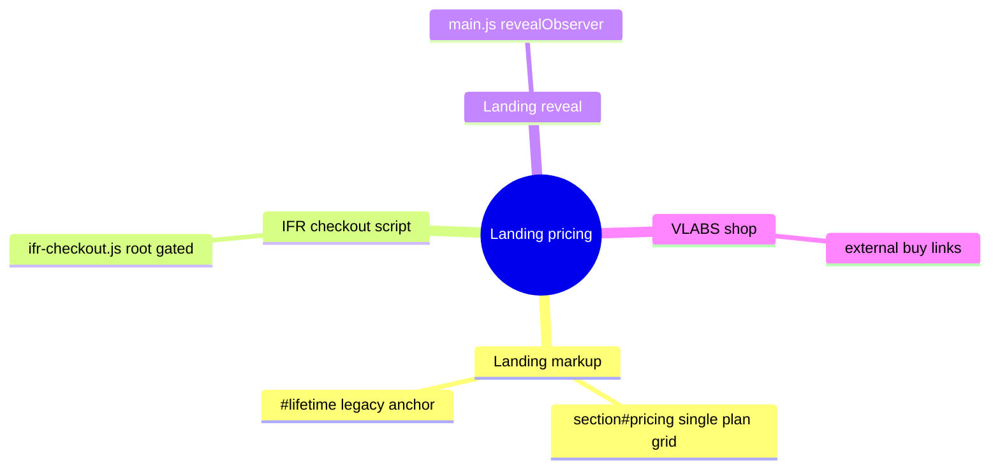

# Architecture map (narrow trace: landing pricing)

Scope: only the static landing -> lifetime offer / IFR holder section hop
(issue #208). Not a full repository map.

## 1. Core idea

- The static site presents SecureCall and sells paid editions as one-time
  lifetime licences through the VLABS shop (`website/index.html` `#pricing`,
  `docs/PRICING.md`).
- The Free edition stays €0 and links to the download section
  (`website/index.html` Free card -> `#download`).
- IFR holders get a planned browser-verified discount; verification and
  checkout are gated off (`data-ifr-enabled="false"`, `website/js/ifr-checkout.js`).

## 2. Trace

1. `website/index.html::nav a[href="#pricing"|"#lifetime"]` -> `website/index.html::section#pricing` (fragment; `#lifetime` is a legacy anchor on its section head)
2. `section#pricing::.pricing-grid` -> `https://vlabs.gr/en/shop?focus=one-click-apps` (Pro/Premium Lifetime buy links)
3. `section#pricing::.pricing-grid` Free card -> `website/index.html::section#download` (`#download`)
4. `section#pricing::div#ifr[data-ifr-checkout]` -> `website/js/ifr-checkout.js::root` (DOM query; controls stay disabled)
5. `website/js/main.js::revealObserver` -> `.reveal` cards (visibility only)

## 3. Modules

| Module | Task | Entry | State |
| --- | --- | --- | --- |
| Landing markup | Render the single plan grid and IFR box | `website/index.html::section#pricing` | built |
| IFR checkout script | Bind wallet/discount controls to `#ifr` | `website/js/ifr-checkout.js::root` | built (gated) |
| Landing reveal | Animate `.reveal` elements | `website/js/main.js::revealObserver` | built |
| VLABS shop | External purchase and activation-code email | shop URL | external |
| Truth tests | Guard prices, links, single grid, anchors | `website/js/*.test.cjs` | built |

## 4. Wiring

- Navigation and sister pages (`./#pricing`, `./#lifetime`) land on the one pricing section.
- Paid lifetime cards hand off to the VLABS shop; no checkout runs on the page.
- The Free card hands off to the in-page download section.
- `ifr-checkout.js` finds `[data-ifr-checkout]` inside `#pricing`; its gates are unchanged.
- `main.js` only toggles visibility of `.reveal` cards.
- `landing.css` reserves desktop/mobile fixed-header clearance for direct `#lifetime` fragments; the landing stylesheet URL is versioned for cache refresh.

## 5. Contradictions and gaps

- Before #208 the paid offer rendered twice (`Access levels` grid and `Lifetime licences` grid). Resolved: one grid (Free, Pro Lifetime, Premium Lifetime).
- Open: IFR discount checkout stays disabled pending payment and fiscal approval.

## 6. Diagrams

- `docs/architecture/map.puml` (mindmap + components)
- `docs/architecture/main-path.puml` (sequence of the trace)

## 7. Next step

Module: Landing markup, hop 1-3, including fragment clearance in `website/css/landing.css`.
Untouched: `website/js/ifr-checkout.js`, `website/js/main.js`, sister pages.

---

# Narrow trace: Android heartbeat -> reconnect (issue #211)

Scope: only the existing staleness hop in
`client_android/app/src/main/java/com/securecall/app/net/HeartbeatClient.kt`.
`HeartbeatClient` owns all reconnect scheduling; `WebSocketService` only reacts.

## Trace

1. `startHeartbeat()::TimerTask.run` -> staleness check (`_lastSeen` older than 45s / 120s in call)
2. staleness -> `Handler(mainLooper).post` -> `state = DISCONNECTED`, `ws = null`, `oldWs.cancel()`, `listener.onDisconnected()`
3. same main-thread block -> `scheduleReconnect()` (guards: `isClosed`, `inRecoveryMode`, `reconnectPending`; backoff unchanged)
4. `scheduleReconnect()::postDelayed` -> `connect()` -> `okClient.newWebSocket`

## Gap resolved

- Before #211 hop 3 relied on `onFailure` from `oldWs.cancel()`; because `ws` was cleared
  first, the stale-socket guard (`webSocket !== ws`) dropped that callback and no reconnect was
  scheduled. Hop 3 now calls the existing `scheduleReconnect()` directly; the cancelled socket's
  `onFailure` stays ignored, so exactly one retry is queued.
- Untouched: `onClosing` 1000 policy, 4000..4099 hard stop, `close()`, flap recovery, backoff,
  TLS/pins, URLs. Guarded by `app/src/test/.../net/HeartbeatClientStaleReconnectTest.kt`.
