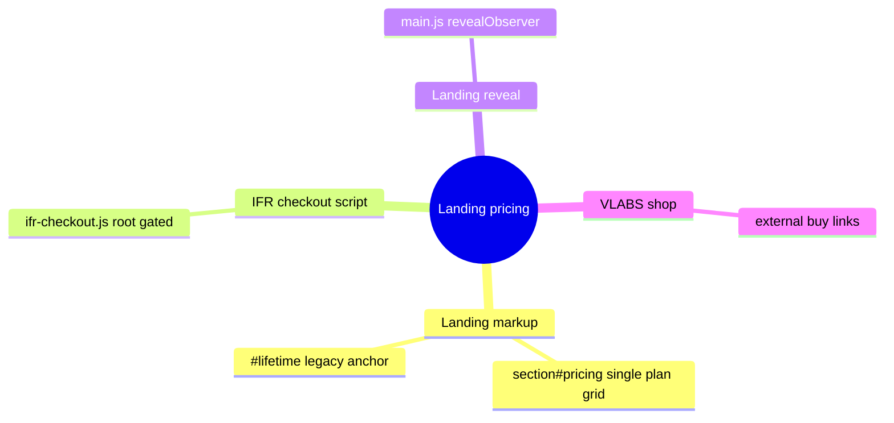

# Architecture map (narrow trace: landing pricing)

Scope: only the static landing -> lifetime offer / IFR holder section hop
(issue #208). Not a full repository map.

## 1. Core idea

- The static site presents SecureCall and sells paid editions as one-time
  lifetime licences through the VLABS shop (`website/index.html` `#pricing`,
  `docs/PRICING.md`).
- The Free edition stays €0 and links to the download section
  (`website/index.html` Free card -> `#download`).
- IFR holders get a planned browser-verified discount; verification and
  checkout are gated off (`data-ifr-enabled="false"`, `website/js/ifr-checkout.js`).

## 2. Trace

1. `website/index.html::nav a[href="#pricing"|"#lifetime"]` -> `website/index.html::section#pricing` (fragment; `#lifetime` is a legacy anchor on its section head)
2. `section#pricing::.pricing-grid` -> `https://vlabs.gr/en/shop?focus=security` (Pro/Premium Lifetime buy links)
3. `section#pricing::.pricing-grid` Free card -> `website/index.html::section#download` (`#download`)
4. `section#pricing::div#ifr[data-ifr-checkout]` -> `website/js/ifr-checkout.js::root` (DOM query; controls stay disabled)
5. `website/js/main.js::revealObserver` -> `.reveal` cards (visibility only)

## 3. Modules

| Module | Task | Entry | State |
| --- | --- | --- | --- |
| Landing markup | Render the single plan grid and IFR box | `website/index.html::section#pricing` | built |
| IFR checkout script | Bind wallet/discount controls to `#ifr` | `website/js/ifr-checkout.js::root` | built (gated) |
| Landing reveal | Animate `.reveal` elements | `website/js/main.js::revealObserver` | built |
| VLABS shop | External purchase and activation-code email | shop URL | external |
| Truth tests | Guard prices, links, single grid, anchors | `website/js/*.test.cjs` | built |

## 4. Wiring

- Navigation and sister pages (`./#pricing`, `./#lifetime`) land on the one pricing section.
- Paid lifetime cards hand off to the VLABS shop; no checkout runs on the page.
- The Free card hands off to the in-page download section.
- `ifr-checkout.js` finds `[data-ifr-checkout]` inside `#pricing`; its gates are unchanged.
- `main.js` only toggles visibility of `.reveal` cards.
- `landing.css` reserves desktop/mobile fixed-header clearance for direct `#lifetime` fragments; the landing stylesheet URL is versioned for cache refresh.

## 5. Contradictions and gaps

- Before #208 the paid offer rendered twice (`Access levels` grid and `Lifetime licences` grid). Resolved: one grid (Free, Pro Lifetime, Premium Lifetime).
- Open: IFR discount checkout stays disabled pending payment and fiscal approval.

## 6. Diagrams

- `docs/architecture/map.puml` (mindmap + components)
- `docs/architecture/main-path.puml` (sequence of the trace)

## 7. Next step

Module: Landing markup, hop 1-3, including fragment clearance in `website/css/landing.css`.
Untouched: `website/js/ifr-checkout.js`, `website/js/main.js`, sister pages.

---

# Narrow trace: Android heartbeat -> reconnect (issue #211)

Scope: only the existing staleness hop in
`client_android/app/src/main/java/com/securecall/app/net/HeartbeatClient.kt`.
`HeartbeatClient` owns all reconnect scheduling; `WebSocketService` only reacts.

## Trace

1. `startHeartbeat()::TimerTask.run` -> staleness check (`_lastSeen` older than 45s / 120s in call)
2. staleness -> `Handler(mainLooper).post` -> `state = DISCONNECTED`, `ws = null`, `oldWs.cancel()`, `listener.onDisconnected()`
3. same main-thread block -> `scheduleReconnect()` (guards: `isClosed`, `inRecoveryMode`, `reconnectPending`; backoff unchanged)
4. `scheduleReconnect()::postDelayed` -> `connect()` -> `okClient.newWebSocket`

## Gap resolved

- Before #211 hop 3 relied on `onFailure` from `oldWs.cancel()`; because `ws` was cleared
  first, the stale-socket guard (`webSocket !== ws`) dropped that callback and no reconnect was
  scheduled. Hop 3 now calls the existing `scheduleReconnect()` directly; the cancelled socket's
  `onFailure` stays ignored, so exactly one retry is queued.
- Untouched: `onClosing` 1000 policy, 4000..4099 hard stop, `close()`, flap recovery, backoff,
  TLS/pins, URLs. Guarded by `app/src/test/.../net/HeartbeatClientStaleReconnectTest.kt`.

---

# Narrow trace: Android policy stop -> warm resume (issue #220)

Scope: `SecureCallApplication`, `WebSocketService`, a read-only lifecycle accessor
in `HeartbeatClient`, and existing status wiring in `MainActivity`. No call,
foreground-service API, preference, authentication or reconnect-policy redesign.

| Module | Ownership | Hop |
| --- | --- | --- |
| Application lifecycle | Main-thread activity count, 15s stop and one-shot resume intent | activity stop -> policy stop -> service destruction -> foreground start |
| Signaling service | Own client teardown and instance-scoped offline publication | onDestroy -> client close -> Application completion |
| Heartbeat client | Read-only eligibility; all socket retries stay here | connected, not closed/recovering/retrying -> eligible snapshot before close |
| Main activity | Current service's status callbacks and bounded existing binding retries | onResume/offline -> rebind -> current-state refresh |

- Application remembers the exact service requested to stop, not an arbitrary absence.
  It waits for that instance's destruction before starting via its existing
  foreground-service startup path. A return before the delayed stop only cancels it.
- Eligibility is sampled immediately before intentional client close. Only an
  established CONNECTED client with no pending retry/recovery and no connection
  attempt in the existing 10s flap window is resumable. A
  disconnected/connecting client, manual close, auth400x or clean1000 is not.
  Interrupted retry/backoff/recovery is deliberately not reconstructed in a new client.
- Service destruction clears its own connection/registration state; only the current
  instance clears the singleton and publishes offline. A replacement is untouched.
- MainActivity detaches obsolete callbacks, checks instance ownership again on UI
  delivery, and refreshes an already-connected replacement without reconnecting it.
- Process-local only: cold startup/call startup, task removal, FCM, Android API35+
  background policy and preference defaults are unchanged. Device proof is separate.

---

# Narrow trace: German Google Play listing metadata (2026-11-16)

- Module: static Play listing metadata, not application runtime or direct-download offers.
- Source: `fastlane/metadata/android/en-US/{title,short_description,full_description}.txt`.
- Hop: accepted English listing meaning -> German
  `fastlane/metadata/android/de-DE/{title,short_description,full_description}.txt`
  -> manual transfer by the parent operator to the German Play Console listing.
- Gap: German listing text was missing locally; the parent reports stale public
  auto-translation and only an English Console locale. The new files supply an
  explicit translation, not an automated uploader or a Console acceptance receipt.
- Preserve the three public URLs, no Play-owned VPN, no WalletConnect/in-app IFR
  unlock, and unavailable paid controls pending separate release gates.
- Checks: exact five-file allowlist, strict UTF-8, Unicode character limits,
  URL parity, mandatory caveats, semantic review and `git diff --check`.
- Open: parent-owned Console language addition/manual transfer, Google review and
  public German listing verification. No language-tag or changelog edit here.
- Untouched: English metadata, all changelogs, app/runtime, permissions, screenshots,
  distribution matrix, offers and diagram files. No build or deployment.

---

# Narrow trace: SecureCall purchase category links (issue #226)

- Module: public landing purchase links and their download/help/template mirrors.
- Hop: `website/index.html::section#pricing` and existing SecureCall purchase
  references -> `https://vlabs.gr/{en|de|el}/shop?focus=security`.
- Only the category query changes; language, prices, licence scope, download
  destinations, Free/Play/direct distribution copy and IFR gates stay unchanged.
- README and `docs/WIKI` contain no affected category URL and remain untouched;
  the separate SecureChat/Chameleon FAQ purchase link is outside this task.
- Regression: `website/js/product-truth.test.cjs` checks all 26 static SecureCall
  purchase targets; existing template tests exercise both paid CTAs in en/de/el.
- Source suite: `node --test website/js/*.test.cjs` -> 61/61 PASS; the new category
  regression fails on the original links and passes after the URL-only correction.
- Open: parent-owned responsive browser checks and publication. No visual or
  checkout-readiness acceptance is asserted; application/runtime and diagrams
  remain unchanged.

---

# Narrow trace: signaling XML dependency lock (alert #38, 2026-11-16)

- Module: signaling optional XML dependency closure, not application code.
- Hop: `backend/signaling/package.json::firebase-admin` -> locked
  `firebase-admin@13.10.0::optionalDependencies[@google-cloud/storage]` ->
  `@google-cloud/storage@7.19.0::dependencies[fast-xml-parser]` (`^5.3.4`).
- The existing range permits `fast-xml-parser@5.12.0`, the first patched
  version for GHSA-474x-hrwr-fgx4 (affected `<=5.11.2`). The advisory concerns
  quadratic CPU consumption with non-default `stopNodes`; application-level
  exposure was not traced or tested in this lockfile-only task.
- Only `backend/signaling/package-lock.json` changes: parser 5.7.2 -> 5.12.0,
  five required XML support-package upgrades, and two required new support
  packages. All eight records match exact official npm version metadata.
- Direct policy, overrides, scripts, existing parent packages and every other
  lockfile record are preserved. No override, source or runtime-path change.
- Source checks: JSON/metadata/dependency-range/preservation assertions and
  `git diff --check` PASS. Full install, reproducer, tests, lint, build and CI
  NOT_RUN under host CPU HOLD; parent owns subsequent diff review and checks.
- This is an uncommitted source candidate, not runtime compatibility, alert
  closure or release acceptance. Diagram files remain unchanged.

---

# Narrow trace: ACTIVE signaling session lifecycle (2026-11-16)

- Module: signaling heartbeat and existing WS/call route ownership.
- Hop: `server.js::new HeartbeatManager(routingTable, clients, clientIds)` ->
  `heartbeat.js::start` -> shared `clients` / `routingTable` maps.
- Liveness: `ws/index.js::pong|message` -> `updateClient(connId)` updates
  `lastSeen`, not `session.updated`. `call.js::CALL_KEY_CONFIRM` enters ACTIVE;
  `webrtc.js::activeSession` subsequently requires that route to exist.
- Teardown: heartbeat timeout -> `ws.terminate()` -> asynchronous
  `ws/index.js::close` -> current `clientIds` owner check -> peer CALL_END,
  route deletion, binding deletion, IP decrement and rate-limit cleanup.
- Replacement: registration/contact handlers rebind `clientIds`; close of a
  superseded connection must not delete the replacement's route or binding.
- Red evidence: actual manager + dispatcher + call/WebRTC handlers, synthetic
  peers and bounded fake time in `heartbeat_lifecycle.test.js`: healthy ACTIVE
  disappears at 65s; delete-before-close loses teardown metadata; failed ping
  deletes a client without terminating its socket. Four of eight cases pass
  (pending expiry, current close, superseded close, explicit END/BUSY).
- Initial scope/design blocker: heartbeat had no authoritative `clientIds` reference.
  A safe ownership-aware fix needs the existing map passed at the server
  construction hop (one additional source file), not a second registry.
  The traced call handlers have no ACTIVE route-count/per-peer admission cap;
  the WS message limiter bounds rate, not lifetime accumulation. Keeping every
  ACTIVE route while both peers answer pings is not a bounded session policy.
- Initial next step: parent decides the bounded ACTIVE-retention/admission contract and
  authorizes the exact extra ownership wiring before implementation. No new
  timeout, transfer, registry or maintenance policy is selected here.
- Initial changes were test + this map only; heartbeat, package test chain, server,
  Android, security/protocol, limits and diagram files remain untouched.
  No green fix, full-suite, live call, media, drain or device proof is claimed.

## Parent-bounded extension (approved before feature edits)

- Ownership hop: `server.js` passes the existing `clientIds` map to the
  manager; ACTIVE lifetime follows both current participant records, including
  termination until WS close owns notification and metadata cleanup. Unowned
  ACTIVE and pending routes retain the existing 60s timestamp expiry.
- Admission hop: both `call.js::authenticatedInvite|legacyInvite` -> shared
  in-module admission check over `routingTable` -> existing forward/push/set.
  Before those side effects, reject at 10000 global routes or 32 originating
  routes (all states) with the existing `rate_limited` shape. Originator comes
  from trusted connection context, never `msg.from`; no recipient quota,
  eviction, second registry, config flag, tier or conversation-duration rule.
- Exact scope: heartbeat, one server constructor line, call admission, the
  lifecycle test, one capacity test, package test-chain wiring and this map.
  Parent owns full locked CI, exact-head security and release acceptance.

## Implemented candidate and focused evidence

- `HeartbeatManager` now resolves both ACTIVE participant IDs through the
  authoritative binding map and checks the current record's `clientId`.
  Open clients retain the existing idle deadlines; ping errors terminate.
  Non-open sockets and their metadata remain for real WS close cleanup.
- Both invite paths check current caller ownership and the shared admission
  bounds before forwarding, push or insertion. Denial never evicts routes;
  counts derive from the existing table, so END/BUSY, expiry and close release
  capacity without a separate counter. Recipient load does not consume the
  caller's quota, and a supplied `msg.from` cannot choose the charged identity.
- Before feature edits: lifecycle 5/11 PASS (healthy ACTIVE lost at 65s,
  termination metadata lost, failed-ping socket not terminated); capacity
  4/18 PASS (both protocols admitted beyond the intended ceilings).
- Before the transport extension, `npm run test:call-lifecycle` ran only the
  standard-Node tests: lifecycle 12/12 and capacity 20/20 PASS.
  This includes a 10-minute synthetic ACTIVE lifecycle with later WebRTC
  signaling, pending/orphan deadlines, one-peer timeout notification,
  superseded ownership, exact capacity boundaries, no-side-effect denials,
  both protocols and quota reuse after END/BUSY, expiry and close.
- The package pretest chain includes the focused chain. Full backend/Android,
  lint, secret CI and scoped security review remain parent-owned and NOT_RUN
  locally. No app server, install, network, device, provider or live call/media/
  drain test was performed; diagram files and WS close implementation are unchanged.

## Real-transport regression source (parent execution required)

- Eighth file: `src/__tests__/heartbeat_transport.test.js`, included in the
  same `test:call-lifecycle` / pretest chain. Production logic is unchanged.
- Hop: test-owned `127.0.0.1:0` HTTP/WSS -> real `ws` peers -> existing
  `ws/index.js::setup` + `HeartbeatManager` -> real terminate/close callbacks.
  Synthetic already-verified records and a test-owned limiter isolate stores,
  registration, providers, application startup and media from this test.
- Three source cases: current timeout cleanup + peer notification, injected
  ping failure + actual termination/close, superseded old-socket termination
  preserving the replacement binding and ACTIVE route without CALL_END.
- Fake interval capture and clock are synchronous and immediately restored.
  Each case has a 4s deadline, cleanup a 2s deadline, the suite a 20s deadline;
  finally terminates only owned peers, destroys owned TCP sockets, closes WSS/
  HTTP, clears timers and restores logging. Results contain fixed labels only.
- New transport test and expanded chain: NOT_RUN locally under host HOLD.
  Syntax/source checks are not transport acceptance. Executed 12+20 PASS
  remains separate; parent hosted locked npm-ci/full CI must run all cases
  and perform scoped exact-candidate security review before integration.

---

# Narrow trace: STX24 authenticated call media (SC-STX24-AUTHENTICATED-MEDIA-20261116)

- Module: call media path + shared signed call transcript, not registration,
  routing lifecycle, SDP/ICE, VPN flavors or UI.
- Send hop: `WebSocketService.sendBinary` -> current `MediaSessionV3.seal`
  (per-direction key, monotonically increasing sequence) -> JNI
  `CoreCrypto.mediaSeal` -> `aead::seal_media_frame` -> `WebRtcManager.send`
  (DataChannel only; unchanged).
- Receive hop: `WebRtcManager.dcObserver.onMessage` -> `onDataReceived` of the
  manager that `startWebRtc` created -> `WebSocketService.receiveDataChannelMedia`
  (exact current manager + session + media session, else drop) ->
  `MediaSessionV3.open` (lock; length check; replay state passed in, committed
  only after AEAD success) -> JNI `CoreCrypto.mediaOpen` ->
  `aead::open_media_frame` (bounded header checks before allocation, existing
  `ReplayDetector` on a copy, XChaCha20Poly1305 with header AAD) ->
  `OpusDecoder` -> `JitterBuffer`.
- Removed entry: `HeartbeatClient.Listener.onBinaryMessage` (WebSocket binary)
  no longer reaches decryption/playback; it only drops and logs.
- Key hop: `CoreCrypto.deriveSessionKey` (X25519 + HKDF, unchanged) ->
  `SessionKeyBinding.deriveV3(base, inviteDigest, acceptDigest)` -> HKDF
  expand: call key (CALL_KEY_CONFIRM + SAS, v3 labels) and two media keys
  (`caller->callee`, `callee->caller`). Base/private keys are wiped as before.
- Negotiation hop: signed `CALL_INVITE`/`CALL_ACCEPT` transcript v3 with
  `securecall-call-*-v3` labels and an explicit `securecall-media-frame-v3`
  field -> server `call.js` protocol 3 path (session pinned to its protocol;
  accept/confirm must match) -> peer verification. Protocol 2 server path is
  unchanged for old-to-old clients. New clients verify v3 only; a valid v2
  invite is rejected explicitly (`peer_media_upgrade_required`), never served.
- Teardown: `clearSession` closes the media session (keys + replay state
  cleared together) before the WebRTC manager is closed.
- Untouched: identity registration v2, `WebRtcManager`, SDP/ICE, heartbeat/
  reconnect, FCM payload builder, generic `CoreCrypto.encrypt/decrypt`,
  routing/admission/timeouts, manifests, flavors, UI layout, dependencies.
- Release limitation: new-to-old and old-to-new calls fail (update required);
  this is not a compatibility pass. Runtime/codec/transport evidence NOT_RUN.

## Delta cycle (parent findings A-E)

- Consume hop (A): `receiveDataChannelMedia` -> `MediaSessionV3.consume(frame,
  consumer)`. Under the session lock: open, atomic replay commit, then the
  consumer (Opus decode -> `JitterBuffer.push` -> `startJitterPlayback`), then
  plaintext wipe. `close()` takes the same lock, so it waits for an in-flight
  consumer and no consumer starts after it returns. `clearSession` calls it
  before `webRtcManager.close()`/`killAllAudio()`; no service-wide lock is held
  across native transport dispose, and the consumer takes no service monitor.
- Plaintext bound (D): `native-lib.cpp` encodes into `MAX_PACKET = 4000`, so the
  media plaintext limit is 4000 in Rust (`MEDIA_MAX_PLAINTEXT`) and Kotlin
  (`MediaSessionV3.MAX_PLAINTEXT`); frame max 4060. Codec untouched.
- Interop (E) unchanged: v3 -> old callee still ends as ring timeout, not as a
  detected-old-peer error; no capability handshake added.
