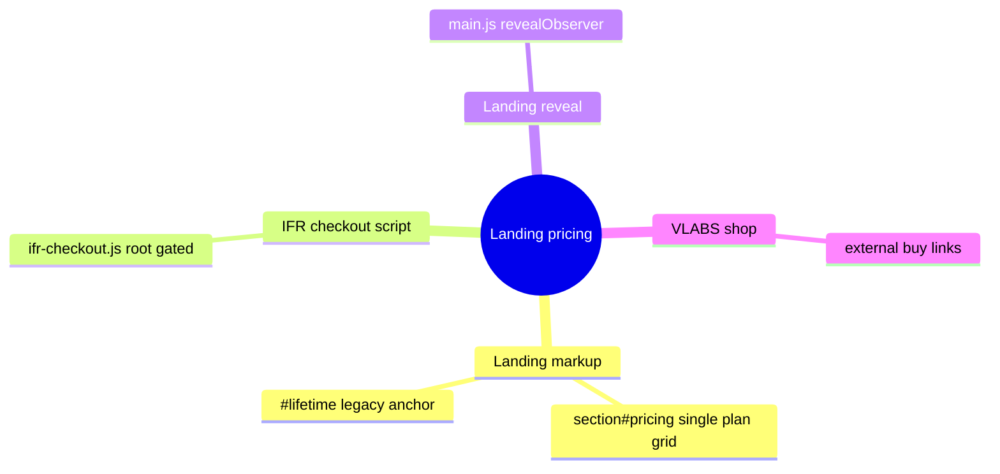

# Architecture map (narrow trace: landing pricing)

Scope: only the static landing -> lifetime offer / IFR holder section hop
(issue #208). Not a full repository map.

## 1. Core idea

- The static site presents SecureCall and sells paid editions as one-time
  lifetime licences through the VLABS shop (`website/index.html` `#pricing`,
  `docs/PRICING.md`).
- The Free edition stays €0 and links to the download section
  (`website/index.html` Free card -> `#download`).
- IFR holders get a planned browser-verified discount; verification and
  checkout are gated off (`data-ifr-enabled="false"`, `website/js/ifr-checkout.js`).

## 2. Trace

1. `website/index.html::nav a[href="#pricing"|"#lifetime"]` -> `website/index.html::section#pricing` (fragment; `#lifetime` is a legacy anchor on its section head)
2. `section#pricing::.pricing-grid` -> `https://vlabs.gr/en/shop?focus=security` (Pro/Premium Lifetime buy links)
3. `section#pricing::.pricing-grid` Free card -> `website/index.html::section#download` (`#download`)
4. `section#pricing::div#ifr[data-ifr-checkout]` -> `website/js/ifr-checkout.js::root` (DOM query; controls stay disabled)
5. `website/js/main.js::revealObserver` -> `.reveal` cards (visibility only)

## 3. Modules

| Module | Task | Entry | State |
| --- | --- | --- | --- |
| Landing markup | Render the single plan grid and IFR box | `website/index.html::section#pricing` | built |
| IFR checkout script | Bind wallet/discount controls to `#ifr` | `website/js/ifr-checkout.js::root` | built (gated) |
| Landing reveal | Animate `.reveal` elements | `website/js/main.js::revealObserver` | built |
| VLABS shop | External purchase and activation-code email | shop URL | external |
| Truth tests | Guard prices, links, single grid, anchors | `website/js/*.test.cjs` | built |

## 4. Wiring

- Navigation and sister pages (`./#pricing`, `./#lifetime`) land on the one pricing section.
- Paid lifetime cards hand off to the VLABS shop; no checkout runs on the page.
- The Free card hands off to the in-page download section.
- `ifr-checkout.js` finds `[data-ifr-checkout]` inside `#pricing`; its gates are unchanged.
- `main.js` only toggles visibility of `.reveal` cards.
- `landing.css` reserves desktop/mobile fixed-header clearance for direct `#lifetime` fragments; the landing stylesheet URL is versioned for cache refresh.

## 5. Contradictions and gaps

- Before #208 the paid offer rendered twice (`Access levels` grid and `Lifetime licences` grid). Resolved: one grid (Free, Pro Lifetime, Premium Lifetime).
- Open: IFR discount checkout stays disabled pending payment and fiscal approval.

## 6. Diagrams

- `docs/architecture/map.puml` (mindmap + components)
- `docs/architecture/main-path.puml` (sequence of the trace)

## 7. Next step

Module: Landing markup, hop 1-3, including fragment clearance in `website/css/landing.css`.
Untouched: `website/js/ifr-checkout.js`, `website/js/main.js`, sister pages.

---

# Narrow trace: Android heartbeat -> reconnect (issue #211)

Scope: only the existing staleness hop in
`client_android/app/src/main/java/com/securecall/app/net/HeartbeatClient.kt`.
`HeartbeatClient` owns all reconnect scheduling; `WebSocketService` only reacts.

## Trace

1. `startHeartbeat()::TimerTask.run` -> staleness check (`_lastSeen` older than 45s / 120s in call)
2. staleness -> `Handler(mainLooper).post` -> `state = DISCONNECTED`, `ws = null`, `oldWs.cancel()`, `listener.onDisconnected()`
3. same main-thread block -> `scheduleReconnect()` (guards: `isClosed`, `inRecoveryMode`, `reconnectPending`; backoff unchanged)
4. `scheduleReconnect()::postDelayed` -> `connect()` -> `okClient.newWebSocket`

## Gap resolved

- Before #211 hop 3 relied on `onFailure` from `oldWs.cancel()`; because `ws` was cleared
  first, the stale-socket guard (`webSocket !== ws`) dropped that callback and no reconnect was
  scheduled. Hop 3 now calls the existing `scheduleReconnect()` directly; the cancelled socket's
  `onFailure` stays ignored, so exactly one retry is queued.
- Untouched: `onClosing` 1000 policy, 4000..4099 hard stop, `close()`, flap recovery, backoff,
  TLS/pins, URLs. Guarded by `app/src/test/.../net/HeartbeatClientStaleReconnectTest.kt`.

---

# Narrow trace: Android policy stop -> warm resume (issue #220)

Scope: `SecureCallApplication`, `WebSocketService`, a read-only lifecycle accessor
in `HeartbeatClient`, and existing status wiring in `MainActivity`. No call,
foreground-service API, preference, authentication or reconnect-policy redesign.

| Module | Ownership | Hop |
| --- | --- | --- |
| Application lifecycle | Main-thread activity count, 15s stop and one-shot resume intent | activity stop -> policy stop -> service destruction -> foreground start |
| Signaling service | Own client teardown and instance-scoped offline publication | onDestroy -> client close -> Application completion |
| Heartbeat client | Read-only eligibility; all socket retries stay here | connected, not closed/recovering/retrying -> eligible snapshot before close |
| Main activity | Current service's status callbacks and bounded existing binding retries | onResume/offline -> rebind -> current-state refresh |

- Application remembers the exact service requested to stop, not an arbitrary absence.
  It waits for that instance's destruction before starting via its existing
  foreground-service startup path. A return before the delayed stop only cancels it.
- Eligibility is sampled immediately before intentional client close. Only an
  established CONNECTED client with no pending retry/recovery and no connection
  attempt in the existing 10s flap window is resumable. A
  disconnected/connecting client, manual close, auth400x or clean1000 is not.
  Interrupted retry/backoff/recovery is deliberately not reconstructed in a new client.
- Service destruction clears its own connection/registration state; only the current
  instance clears the singleton and publishes offline. A replacement is untouched.
- MainActivity detaches obsolete callbacks, checks instance ownership again on UI
  delivery, and refreshes an already-connected replacement without reconnecting it.
- Process-local only: cold startup/call startup, task removal, FCM, Android API35+
  background policy and preference defaults are unchanged. Device proof is separate.

---

# Narrow trace: Android manual Direct update handoff (2026-11-16)

Scope: existing `UpdateManager` manual Settings action only; not commerce or an
automatic updater. Source base: `42b336da8c18eb7f0a12bb3e6dc3cc4c834c6781`.

1. `SettingsFragment.setupAboutLinks::pref_check_update` ->
   `UpdateManager.getUpdateLabel` / `checkAndPromptUpdate(Activity)` (manual tap).
2. `checkAndPromptUpdate` -> `UpdateChecker.isAdbOnlyFlavor` (Pro/Premium build
   flavor, not entitlement). Baseline incorrectly ends at an ADB-only toast.
3. Candidate: the paid manual branch -> Android `ACTION_VIEW` with only
   `https://stealthx.tech/download.html`; missing/denied browser -> existing-style
   short feedback, no fallback destination or state mutation.

| Module | Ownership | State |
| --- | --- | --- |
| Settings | Existing manual entry and summary | Built, unchanged caller |
| UpdateManager | Manual paid handoff and launch-failure feedback | Bounded candidate |
| UpdateChecker | Existing paid internal-check suppression | Built, unchanged |

Untouched: automatic checks, legacy `openUpdate`, Free in-app checking, Play-store
routing, entitlement/activation/proof, policy flags, pricing, website, installer,
signing/version, resources/layout and the signed 78020 worktree/artifacts.
JVM regression tests cover this hop only. Device/browser/visual acceptance and
integration belong to the parent; no checkout, sale or release readiness implied.

The existing Android Client CI invocation now executes Pro unit tests alongside
Free and Premium, covering the same shared handoff under both paid build flags.
No CI gate is skipped; this is qualification wiring for the mapped manual hop.

---

# Narrow trace: German Google Play listing metadata (2026-11-16)

- Module: static Play listing metadata, not application runtime or direct-download offers.
- Source: `fastlane/metadata/android/en-US/{title,short_description,full_description}.txt`.
- Hop: accepted English listing meaning -> German
  `fastlane/metadata/android/de-DE/{title,short_description,full_description}.txt`
  -> manual transfer by the parent operator to the German Play Console listing.
- Gap: German listing text was missing locally; the parent reports stale public
  auto-translation and only an English Console locale. The new files supply an
  explicit translation, not an automated uploader or a Console acceptance receipt.
- Preserve the three public URLs, no Play-owned VPN, no WalletConnect/in-app IFR
  unlock, and unavailable paid controls pending separate release gates.
- Checks: exact five-file allowlist, strict UTF-8, Unicode character limits,
  URL parity, mandatory caveats, semantic review and `git diff --check`.
- Open: parent-owned Console language addition/manual transfer, Google review and
  public German listing verification. No language-tag or changelog edit here.
- Untouched: English metadata, all changelogs, app/runtime, permissions, screenshots,
  distribution matrix, offers and diagram files. No build or deployment.

---

# Narrow trace: SecureCall purchase category links (issue #226)

- Module: public landing purchase links and their download/help/template mirrors.
- Hop: `website/index.html::section#pricing` and existing SecureCall purchase
  references -> `https://vlabs.gr/{en|de|el}/shop?focus=security`.
- Only the category query changes; language, prices, licence scope, download
  destinations, Free/Play/direct distribution copy and IFR gates stay unchanged.
- README and `docs/WIKI` contain no affected category URL and remain untouched;
  the separate SecureChat/Chameleon FAQ purchase link is outside this task.
- Regression: `website/js/product-truth.test.cjs` checks all 26 static SecureCall
  purchase targets; existing template tests exercise both paid CTAs in en/de/el.
- Source suite: `node --test website/js/*.test.cjs` -> 61/61 PASS; the new category
  regression fails on the original links and passes after the URL-only correction.
- Open: parent-owned responsive browser checks and publication. No visual or
  checkout-readiness acceptance is asserted; application/runtime and diagrams
  remain unchanged.

---

# Narrow trace: signaling XML dependency lock (alert #38, 2026-11-16)

- Module: signaling optional XML dependency closure, not application code.
- Hop: `backend/signaling/package.json::firebase-admin` -> locked
  `firebase-admin@13.10.0::optionalDependencies[@google-cloud/storage]` ->
  `@google-cloud/storage@7.19.0::dependencies[fast-xml-parser]` (`^5.3.4`).
- The existing range permits `fast-xml-parser@5.12.0`, the first patched
  version for GHSA-474x-hrwr-fgx4 (affected `<=5.11.2`). The advisory concerns
  quadratic CPU consumption with non-default `stopNodes`; application-level
  exposure was not traced or tested in this lockfile-only task.
- Only `backend/signaling/package-lock.json` changes: parser 5.7.2 -> 5.12.0,
  five required XML support-package upgrades, and two required new support
  packages. All eight records match exact official npm version metadata.
- Direct policy, overrides, scripts, existing parent packages and every other
  lockfile record are preserved. No override, source or runtime-path change.
- Source checks: JSON/metadata/dependency-range/preservation assertions and
  `git diff --check` PASS. Full install, reproducer, tests, lint, build and CI
  NOT_RUN under host CPU HOLD; parent owns subsequent diff review and checks.
- This is an uncommitted source candidate, not runtime compatibility, alert
  closure or release acceptance. Diagram files remain unchanged.

---

# Narrow trace: ACTIVE signaling session lifecycle (2026-11-16)

- Module: signaling heartbeat and existing WS/call route ownership.
- Hop: `server.js::new HeartbeatManager(routingTable, clients, clientIds)` ->
  `heartbeat.js::start` -> shared `clients` / `routingTable` maps.
- Liveness: `ws/index.js::pong|message` -> `updateClient(connId)` updates
  `lastSeen`, not `session.updated`. `call.js::CALL_KEY_CONFIRM` enters ACTIVE;
  `webrtc.js::activeSession` subsequently requires that route to exist.
- Teardown: heartbeat timeout -> `ws.terminate()` -> asynchronous
  `ws/index.js::close` -> current `clientIds` owner check -> peer CALL_END,
  route deletion, binding deletion, IP decrement and rate-limit cleanup.
- Replacement: registration/contact handlers rebind `clientIds`; close of a
  superseded connection must not delete the replacement's route or binding.
- Red evidence: actual manager + dispatcher + call/WebRTC handlers, synthetic
  peers and bounded fake time in `heartbeat_lifecycle.test.js`: healthy ACTIVE
  disappears at 65s; delete-before-close loses teardown metadata; failed ping
  deletes a client without terminating its socket. Four of eight cases pass
  (pending expiry, current close, superseded close, explicit END/BUSY).
- Initial scope/design blocker: heartbeat had no authoritative `clientIds` reference.
  A safe ownership-aware fix needs the existing map passed at the server
  construction hop (one additional source file), not a second registry.
  The traced call handlers have no ACTIVE route-count/per-peer admission cap;
  the WS message limiter bounds rate, not lifetime accumulation. Keeping every
  ACTIVE route while both peers answer pings is not a bounded session policy.
- Initial next step: parent decides the bounded ACTIVE-retention/admission contract and
  authorizes the exact extra ownership wiring before implementation. No new
  timeout, transfer, registry or maintenance policy is selected here.
- Initial changes were test + this map only; heartbeat, package test chain, server,
  Android, security/protocol, limits and diagram files remain untouched.
  No green fix, full-suite, live call, media, drain or device proof is claimed.

## Parent-bounded extension (approved before feature edits)

- Ownership hop: `server.js` passes the existing `clientIds` map to the
  manager; ACTIVE lifetime follows both current participant records, including
  termination until WS close owns notification and metadata cleanup. Unowned
  ACTIVE and pending routes retain the existing 60s timestamp expiry.
- Admission hop: both `call.js::authenticatedInvite|legacyInvite` -> shared
  in-module admission check over `routingTable` -> existing forward/push/set.
  Before those side effects, reject at 10000 global routes or 32 originating
  routes (all states) with the existing `rate_limited` shape. Originator comes
  from trusted connection context, never `msg.from`; no recipient quota,
  eviction, second registry, config flag, tier or conversation-duration rule.
- Exact scope: heartbeat, one server constructor line, call admission, the
  lifecycle test, one capacity test, package test-chain wiring and this map.
  Parent owns full locked CI, exact-head security and release acceptance.

## Implemented candidate and focused evidence

- `HeartbeatManager` now resolves both ACTIVE participant IDs through the
  authoritative binding map and checks the current record's `clientId`.
  Open clients retain the existing idle deadlines; ping errors terminate.
  Non-open sockets and their metadata remain for real WS close cleanup.
- Both invite paths check current caller ownership and the shared admission
  bounds before forwarding, push or insertion. Denial never evicts routes;
  counts derive from the existing table, so END/BUSY, expiry and close release
  capacity without a separate counter. Recipient load does not consume the
  caller's quota, and a supplied `msg.from` cannot choose the charged identity.
- Before feature edits: lifecycle 5/11 PASS (healthy ACTIVE lost at 65s,
  termination metadata lost, failed-ping socket not terminated); capacity
  4/18 PASS (both protocols admitted beyond the intended ceilings).
- Before the transport extension, `npm run test:call-lifecycle` ran only the
  standard-Node tests: lifecycle 12/12 and capacity 20/20 PASS.
  This includes a 10-minute synthetic ACTIVE lifecycle with later WebRTC
  signaling, pending/orphan deadlines, one-peer timeout notification,
  superseded ownership, exact capacity boundaries, no-side-effect denials,
  both protocols and quota reuse after END/BUSY, expiry and close.
- The package pretest chain includes the focused chain. Full backend/Android,
  lint, secret CI and scoped security review remain parent-owned and NOT_RUN
  locally. No app server, install, network, device, provider or live call/media/
  drain test was performed; diagram files and WS close implementation are unchanged.

## Real-transport regression source (parent execution required)

- Eighth file: `src/__tests__/heartbeat_transport.test.js`, included in the
  same `test:call-lifecycle` / pretest chain. Production logic is unchanged.
- Hop: test-owned `127.0.0.1:0` HTTP/WSS -> real `ws` peers -> existing
  `ws/index.js::setup` + `HeartbeatManager` -> real terminate/close callbacks.
  Synthetic already-verified records and a test-owned limiter isolate stores,
  registration, providers, application startup and media from this test.
- Three source cases: current timeout cleanup + peer notification, injected
  ping failure + actual termination/close, superseded old-socket termination
  preserving the replacement binding and ACTIVE route without CALL_END.
- Fake interval capture and clock are synchronous and immediately restored.
  Each case has a 4s deadline, cleanup a 2s deadline, the suite a 20s deadline;
  finally terminates only owned peers, destroys owned TCP sockets, closes WSS/
  HTTP, clears timers and restores logging. Results contain fixed labels only.
- New transport test and expanded chain: NOT_RUN locally under host HOLD.
  Syntax/source checks are not transport acceptance. Executed 12+20 PASS
  remains separate; parent hosted locked npm-ci/full CI must run all cases
  and perform scoped exact-candidate security review before integration.

---

# Narrow trace: STX24 authenticated call media (SC-STX24-AUTHENTICATED-MEDIA-20261116)

- Module: call media path + shared signed call transcript, not registration,
  routing lifecycle, SDP/ICE, VPN flavors or UI.
- Send hop: `WebSocketService.sendBinary` -> current `MediaSessionV3.seal`
  (per-direction key, monotonically increasing sequence) -> JNI
  `CoreCrypto.mediaSeal` -> `aead::seal_media_frame` -> `WebRtcManager.send`
  (DataChannel only; unchanged).
- Receive hop: `WebRtcManager.dcObserver.onMessage` -> `onDataReceived` of the
  manager that `startWebRtc` created -> `WebSocketService.receiveDataChannelMedia`
  (exact current manager + session + media session, else drop) ->
  `MediaSessionV3.open` (lock; length check; replay state passed in, committed
  only after AEAD success) -> JNI `CoreCrypto.mediaOpen` ->
  `aead::open_media_frame` (bounded header checks before allocation, existing
  `ReplayDetector` on a copy, XChaCha20Poly1305 with header AAD) ->
  `OpusDecoder` -> `JitterBuffer`.
- Removed entry: `HeartbeatClient.Listener.onBinaryMessage` (WebSocket binary)
  no longer reaches decryption/playback; it only drops and logs.
- Key hop: `CoreCrypto.deriveSessionKey` (X25519 + HKDF, unchanged) ->
  `SessionKeyBinding.deriveV3(base, inviteDigest, acceptDigest)` -> HKDF
  expand: call key (CALL_KEY_CONFIRM + SAS, v3 labels) and two media keys
  (`caller->callee`, `callee->caller`). Base/private keys are wiped as before.
- Negotiation hop: signed `CALL_INVITE`/`CALL_ACCEPT` transcript v3 with
  `securecall-call-*-v3` labels and an explicit `securecall-media-frame-v3`
  field -> server `call.js` protocol 3 path (session pinned to its protocol;
  accept/confirm must match) -> peer verification. Protocol 2 server path is
  unchanged for old-to-old clients. New clients verify v3 only; a valid v2
  invite is rejected explicitly (`peer_media_upgrade_required`), never served.
- Teardown: `clearSession` closes the media session (keys + replay state
  cleared together) before the WebRTC manager is closed.
- Untouched: identity registration v2, `WebRtcManager`, SDP/ICE, heartbeat/
  reconnect, FCM payload builder, generic `CoreCrypto.encrypt/decrypt`,
  routing/admission/timeouts, manifests, flavors, UI layout, dependencies.
- Release limitation: new-to-old and old-to-new calls fail (update required);
  this is not a compatibility pass. Runtime/codec/transport evidence NOT_RUN.

## Delta cycle (parent findings A-E)

- Consume hop (A): `receiveDataChannelMedia` -> `MediaSessionV3.consume(frame,
  consumer)`. Under the session lock: open, atomic replay commit, then the
  consumer (Opus decode -> `JitterBuffer.push` -> `startJitterPlayback`), then
  plaintext wipe. `close()` takes the same lock, so it waits for an in-flight
  consumer and no consumer starts after it returns. `clearSession` calls it
  before `webRtcManager.close()`/`killAllAudio()`; no service-wide lock is held
  across native transport dispose, and the consumer takes no service monitor.
- Plaintext bound (D): `native-lib.cpp` encodes into `MAX_PACKET = 4000`, so the
  media plaintext limit is 4000 in Rust (`MEDIA_MAX_PLAINTEXT`) and Kotlin
  (`MediaSessionV3.MAX_PLAINTEXT`); frame max 4060. Codec untouched.
- Interop (E) unchanged: v3 -> old callee still ends as ring timeout, not as a
  detected-old-peer error; no capability handshake added.

## Audio stop ownership (SC-AUDIO-STOP-OWNERSHIP-20261117)

- Bounded module: `WebSocketService` audio lifecycle and direct player neighbour
  `GhostAudioPlayer`, not media cryptography (parent feedback extension).
- Proven source race: `handleIncomingMessage::CALL_ACCEPT_ACK` -> `killAllAudio`
  -> `stopAudioPlayback` -> singleton `OpusDecoder.release`, independent of
  `MediaSessionV3.consume` -> decoder init/decode -> jitter enqueue/player start.
  The old stop could free a handle during native decode or clear playback before
  the still-running consumer restarted it. No runtime reproduction is claimed.
- Receive now snapshots an audio generation before admission/authentication;
  the authenticated consumer takes `AudioPlaybackLifecycle` and rechecks current
  manager/media/security-state ownership and service destruction before decoding.
- Stop takes the audio lock, replaces its generation, then clears jitter,
  interrupts playout and terminally retires the player/releases the decoder. Old admitted consumers and old
  playout generations cannot touch replacement audio. Fresh valid current-call
  callbacks may start audio again; a tone stop does not close the crypto session.
- Playout prefill/pop use the generation lock, but player.write runs outside it.
  `GhostAudioPlayer.write` prepares/plays and captures its track under a short
  private state lock; blocking AudioTrack.write runs outside all teardown locks.
  `retire` marks the player terminal and detaches its track under that state lock,
  then stop/release run without that lock, able to interrupt an in-flight write.
  A delayed old worker cannot prepare/play again; a captured old track never
  redirects to a fresh resource. Blocking mode and transfer handling stay unchanged.
- Direct-user check: GhostMediaRouter keeps a persistent player and uses ordinary
  stop/release. Those methods remain reusable; only WebSocketService uses retire,
  discards that player and creates a fresh resource for subsequent valid audio.
- Lock order: existing media consume lock -> audio -> jitter/player-state; audio never takes
  media/service monitors or closes native transport. Existing clearSession order
  remains media.close (returns), transport.close (returns), then audio stop.
- Source regressions: `AudioPlaybackLifecycleTest` has latch-bounded decode/stop,
  pre-stop admission, old playout/current-call reuse and one-way lock-order cases;
  `CallMediaReceiveGateTest` adds mocked blocked-write vs real service stop/retire,
  old-player no-resurrection, fresh-resource playback and legacy release reuse.
  Constructor-bypassed service mocks initialize the lifecycle field.
- Tests/compilation/native/device/runtime: NOT_RUN by source-only authorization.
  Gate tests use synthetic actions; player tests use mocked AudioTracks, not native
  execution. No timeout-based write cancellation or non-blocking mode is introduced.
- Unchanged: accepted consume/close implementation, protocol/keys/replay,
  signaling decisions, reconnect, flavors, native codec and other legacy routers.
- Review fix (SC-AUDIO-STOP-REVIEW-FIX-20261117): `stopAudioPlayback` releases the
  decoder in `finally` when `retire` throws (failure still propagates to the caller's
  log). `CallMediaReceiveGateTest` now drives the real `receiveDataChannelMedia` path
  with an authenticating synthetic cipher: stop during authentication, and manager/
  media/security-state/destroyed swaps, leave decoder/jitter/player/playout untouched
  and media open. Retirement is asserted on player fields. NOT_RUN (source-only).

## Callee accept once (SC-CALL-ACCEPT-ONCE-20261117)

- Module/hop: `WebSocketService.sendCallAccept` (local callee accept) on the existing
  `CallSecurityState`; signed call transcript, crypto, native, timers and queue unchanged.
- Guard: a current state that is claimed or already holds `accept` (caller side) makes any
  local accept a no-op before audio stop, key generation or media replacement (duplicate
  or stale session id). No error is emitted, so the accepted call UI is not torn down.
- Claim: `CallSecurityState.acceptClaim` (AtomicBoolean, body field, outside data equality)
  is set inside the per-state `acceptAdmission` monitor after role/session validation and
  the claim/accept recheck, before `killAllAudio`; no CAS. Overlap losers return.
  Never released: a later local failure (identity/native/key agreement/send) keeps the
  existing fail-closed error and allows no second rekey. A new invite = new state = new claim.
- Unregistered path: stops ringing and queues as before but takes no claim (the queue can
  be cleared on disconnect); the queued callback claims when it runs, extra ones no-op.
- Admission (SC-CALL-ACCEPT-RACE-20261117): `CallSecurityState.acceptAdmission` is a short
  per-invite monitor around the fresh `callSecurityState === state`/claim/accept recheck, the
  registered-vs-queue decision (+ queue add) and the owner's `killAllAudio`. Not held across
  identity, key agreement, `client.send`, `mediaSession.close` or `forceReconnect`; order is
  admission -> audio lifecycle lock only (no caller of `sendCallAccept` holds media/audio locks).
  The lock-free pre-check stays so duplicates return while the owner is stopping ringing.
  Closes: unregistered caller paused after the pre-check stopping audio after another caller
  claimed the invite. Stale state (replaced before admission) returns silently.
- Residual (out of scope): no current state + unregistered still stops audio/queues without
  admission; invite clear/replace concurrent with an admitted caller and the unsynchronized
  `pendingCallQueue` remain broader lifecycle concurrency, intentionally not globally locked.
- Invalid session without an accepted current call keeps `killAllAudio` + `invalid_secure_invite`.
- Regression: `CallAcceptOnceTest` (real entry, synthetic state, bounded latches; 8 tests incl.
  `unregisteredAcceptPausedBeforeAudioStopCannotStopAudioAfterRegisteredClaim`). NOT_RUN.
- Proof (parent-recorded): exact `354913fb58470685f10cbe9a47f5399cb4302459`, hosted JVM run
  44042171861, 8+8 new JVM cases green. JVM/mocked only: no device, native or call success.

---

# Narrow trace: Rust crypto JNI packaging (SC-JNI-V3-PACKAGING-20261117)

- Module: native build/package path of `libsecurecall_core_crypto.so`, not Rust
  algorithms, JNI ABI, `CoreCrypto` methods, flavors or VPN code.
- Build hop (manual): `tools/build_android_crypto.sh` -> `cargo ndk` (3 targets,
  `--release --locked`, 16 KB page flags for aarch64/x86_64) -> `src/main/jniLibs/<abi>/`
  -> `tools/verify_android_crypto_exports.sh` -> stdout provenance receipt (git HEAD,
  `core_crypto` tree, dirty count, Cargo.lock/rustc/cargo-ndk/NDK, per-ABI .so SHA-256).
- Package hop (Gradle): committed jniLibs (not rebuilt by Gradle; CMake builds only the
  Opus JNI lib) -> `verifyCoreCryptoExports` (Exec, NDK `llvm-nm -D --defined-only`,
  `llvm-readelf -lW`) -> every `merge*NativeLibs` (APK, AAB, androidTest APK, all
  flavors). Host unit tests do not merge native libs and do not run the guard.
- Guard contract: arm64-v8a, armeabi-v7a, x86_64 each export
  `Java_com_securecall_crypto_CoreCrypto_{encrypt,decrypt,deriveSessionKey,generateKeyPair,
  selfTest,mediaSeal,mediaOpen}`; 64-bit LOAD align >= 16384. Missing NDK/tool/lib/symbol
  fails; no skip. `JNI_OnLoad` is not required (Rust defines none; static name binding).
- Verified at 354913fb: committed libs lack mediaSeal/mediaOpen on all three ABIs (guard
  exit 1). Unreleased candidate blocker; no production crash is claimed.
- Native proof: `CoreCryptoMediaV3InstrumentedTest` (8 tests, real JNI, synthetic keys,
  fails rather than skips when the library is missing/stale). NOT_RUN until the parent
  rebuilds the three libs from pinned source and runs it on an admitted emulator.

## Native artifact qualification, 2026-11-17

- Actual isolated build44051364431 succeeded: core subtree
  `f08686c2628aabdfdd5123bc363d3b4efb5d0232`, source354913fb,
  Rust1.99.1/NDK27.0.12077973/API24, locked offline dependencies.
  Temporary controllere87aae6c is not application source and must never merge.
- Parent verified receipt/source/controller/hash/ABI bindings, seven JNI exports,
  and 16KiB LOAD alignment on all three artifacts, then replaced only these
  prebuilt libraries. The real packaging export guard passed (all three ABIs).
  Receipt SHA256: `dbfe5ddcf18ac3f463a2ce01479f3b605a8d80b4c845160839e82fdcab7453da`.
- SHA256 arm64-v8a: `2782617de7793cc0040bae2ffff3588350e78734dffe91aaa83edf1f461e4f9f`;
  armeabi-v7a: `01b0ec8a1fda6363baf30eda275cd142f4857743ced8b012798c47afd74d4280`;
  x86_64: `4a932002caab2e585f56950f5ea35d587d4f13b588c62549f5ad513eaf207c59`.
- This is build/ELF/package-guard proof, not Android execution. The eight JNI
  instrumentation tests, codec/audio, calls, interoperability and final release
  integration remain separate open acceptance gates. No customer release.

---

# Narrow trace: Play in-package upgrades (SC-PLAY-UPGRADE-20261116)

## Core Idea And Boundary

Settings must offer Pro/Premium upgrades within `com.securecall.app.free`.
Purchases require authoritative Play verification, durable server entitlement
and matching product/finance readiness. A paid Play tier never adds Direct VPN
(`AGENTS.md`, `docs/DISTRIBUTION_MATRIX.md`). No provider changes in this task.

## Trace And Modules

| Module | Hop and data | Source state before correction |
| --- | --- | --- |
| Settings | `SettingsFragment::configureExternalPurchaseLinks` -> Free-only `UpgradeActivity` (explicit internal intent) | Missing: external-link gate hides the internal upgrade entry too |
| Upgrade UI | `UpgradeActivity::launchPurchase/bindPurchaseButton` -> `BillingManager::launchInAppPurchaseFlow` (`ProductDetails`, price) | Lifetime buttons can fall back to subscription offers |
| Play Billing | `BillingManager::queryExistingPurchases/handlePurchase` -> `UpgradeActivity::onPurchaseCompleted` (tier, token, mutable last product) | Existing SUBS/INAPP restore; callback product association is mutable |
| One-time verification | `PurchaseResultActivity::verifyPurchase` -> `server.js::POST /billing/verify-purchase` -> `google_play_billing::verifyPlayOneTimePurchase/issuePlayActivationCode` | Verified/persisted activation code, not an in-package entitlement |
| Subscription verification | `UpgradeActivity::sendVerificationToBackend` -> `subscription.js::SUBSCRIPTION_VERIFY` -> `verifyPlaySubscription` -> `subscriptions::recordVerifiedSubscription` -> server acknowledgement -> `WebSocketService::handleSubscriptionVerifyAck` | Existing server-authoritative SUBS path only |
| Effective tier | `SubscriptionManager::applyServerVerification/verifyAgainstServer` -> `TierManager::getCurrentTier/applyTier` -> feature registry | Free flavor reads subscription state only; legacy activation strings are not proof |
| Refund/revoke | authenticated `google_play_rtdn::installGooglePlayRtdnRoute` -> subscription expiry/refresh or activation/gift removal -> durable processed IDs | Existing revocation stores; processed ID enters memory before disk write, breaking same-process retry on write failure |

## Wiring And Gaps

- Settings must separate internal Play navigation from forbidden external buy links.
- Lifetime controls must accept only matching INAPP details and Play-provided prices,
  never a historical SUBS offer. Historical subscription restore is not a lifetime sale.
- One-time products currently mint a code with a one-year redemption expiry and two
  uses; `ACTIVATION_CODE_ENABLED=false`, and Play tier resolution does not consume
  that code. No lifetime entitlement lease/ownership/restore contract exists here.
- RTDN removes persisted records; the app learns subscription revocation on its
  existing status revalidation/expiry, not an immediate push to the active UI.
  One-time notifications currently have no entitlement refresh handler.
- Scope of correction: Settings navigation, strict lifetime offer binding, immutable
  callback product binding, and durable RTDN deduplication. Keep both commerce gates
  closed; do not invent SKUs, prices, transfer policy or lifetime access duration.
- Visual contract: visible internal upgrade entry for Free/Pro; external custom-ID
  buy stays hidden; closed purchases show unavailable state; absent/mismatched offers
  cannot enable a buy button. Required later device/layout/state gate is NOT RUN.
- Diagrams for this narrow source trace: this table only; existing landing diagram
  files are unrelated and unchanged. Next hop remains the missing authoritative
  one-time purchase -> persisted same-package lifetime entitlement contract.

## Source Correction Outcome (2026-11-16)

- Internal Settings navigation is now separate from external-link policy and
  refreshed on return. Free/Pro can reach the existing Free-only activity; the
  unavailable state and purchase execution gate remain closed.
- Lifetime/gift controls bind matching INAPP details and nonblank Play prices
  only. Billing callbacks carry their own product/token tuple; unknown or
  ambiguous products do not start verification. No new payment path exists.
- RTDN persists the next processed-ID set before marking the ID in memory. A
  real atomic-write failure regression was RED on the original code and GREEN
  after correction, including duplicate delivery and restart deduplication.
- `npm run test:play-source` PASS: existing Play billing and subscription-store
  assertions plus the new synthetic RTDN route regression. No HTTP server or
  provider client was started. Source contracts and XML syntax PASS.
- Kotlin regressions added/updated but NOT RUN: Settings route/external-link
  isolation, INAPP binding/no SUBS fallback, immutable restore callbacks and
  pending/unknown/ambiguous purchase rejection. Gradle/native/visual tests NOT RUN
  under the Mac heavy-build HOLD. This is PARTIAL, not a sale-ready upgrade.
- Additional inspected gap: `DirectEntitlementStore::verify` explicitly rejects
  `free`; routing Play codes through the Direct verifier is not a valid shortcut.

---

# Assembly note: final candidate (SC-FINAL-CANDIDATE-ASSEMBLY-20261117)

- Direct UpdateManager download handoff (PR224) and Free Settings -> UpgradeActivity ->
  verified Billing/RTDN hops (PR232) merged unchanged onto the media/native candidate
  `d1eefa87`. No new node, path, flag or wrapper; both traces above remain authoritative.

## CI NDK environment pin (SC-FINAL-NDK-CI-ENV-20261117)

- Hop: `ci-basic.yml` Android job -> sdkmanager `ndk;27.0.12077973` -> `Verify Android client`
  -> Gradle `verifyCoreCryptoExports` -> `resolve_ndk` (prefers `ANDROID_NDK_HOME`, checks
  `Pkg.Revision`). Runner ambient `ANDROID_NDK_HOME` pointed at another NDK; the step now
  exports `ANDROID_NDK_HOME`/`ANDROID_NDK_ROOT` = `$ANDROID_HOME/ndk/27.0.12077973`.
  Guard, NDK revision and fail-closed behaviour unchanged.

---

# Narrow trace: same-package Play lifetime (SC-PLAY-LIFETIME-SAME-PACKAGE-20261117)

Module/hop: Free `UpgradeActivity::onPurchaseCompleted` -> `SubscriptionManager::recordPendingPurchase`
-> `subscription.js::SUBSCRIPTION_VERIFY` (lifetime branch `verifyLifetimePurchase`) ->
`google_play_billing::resolveLifetimeProduct` (policy) + `verifyPlayOneTimePurchase` ->
`subscriptions::recordVerifiedLifetime` (durable, identity-bound) -> `acknowledgePlayOneTimePurchase`
-> `markLifetimeAcknowledged` -> `SUBSCRIPTION_VERIFY_ACK` (finite `expiresAt`) ->
`WebSocketService::handleSubscriptionVerifyAck` -> `SubscriptionManager::applyServerVerification` -> `TierManager`.
Restore: same hop (Play INAPP query -> same token record; same identity idempotent).
Refresh: `/subscription/status` -> `getLifetimeEntitlement` -> `lifetimeStatusResponse` (now + policy `proofTtlMs`).
Revoke: RTDN voided / one-time CANCELED -> `revokeLifetimeByPurchaseToken` (tombstone on the same record).

| Node | Change | State |
| --- | --- | --- |
| Upgrade UI | lifetime SKUs no longer open `PurchaseResultActivity`; activation-code SKU unchanged | built |
| Play catalog | `LIFETIME_PRODUCTS`, `normalizeLifetimePolicy`, `resolveLifetimeProduct`, `lifetimeStatusResponse` | built |
| Subscription store | `inapp:<sha256(token)>` lifetime records in the same `subscriptions.json`; monthly paths skip them | built |
| WS handler | lifetime branch inside existing `SUBSCRIPTION_VERIFY`; monthly branch unchanged | built |
| Code route | `/billing/verify-purchase` rejects lifetime products/tokens (code path = activation-code product only) | built |
| RTDN | voided + one-time CANCELED revoke lifetime record; dedup unchanged | built |
| Policy input | `server.js::PLAY_LIFETIME_POLICY = null` (owner-approved tuple/TTL/rebind) | open: owner input |

No new flag, module, database, protocol message or checkout. `PLAY_BILLING_ENABLED`/`BILLING_ENABLED`
stay closed. Missing policy -> `lifetime_entitlement_unavailable`.

## Consistency completion (SC-PLAY-LIFETIME-CONSISTENCY-20261117)

- Same module/hops; preserve the existing lifetime implementation and monthly/gift paths.
- RTDN -> durable unbound token tombstone -> first-record rejection, including restart;
  provider acknowledgement -> synchronous current binding/revocation recheck -> success.
- `server.js` -> read-only `GOOGLE_PLAY_LIFETIME_POLICY_FILE` -> strict normalization;
  no public values/defaults, new enable flag or commerce activation.
- `BillingManager::queryExistingPurchases` joins SUBS+INAPP query results before
  `UpgradeActivity::onPurchasesRestored` records every receipt before sending any request.
  An incomplete query returns an error, not a commercially selected subset.
- `SubscriptionManager` isolates pending receipts and finite verified rights. Final ACKs
  cannot be overwritten by duplicates; HTTP answers are bound to a receipt generation.
  Distinct verified purchases require explicit coexistence policy, never tier ranking.
  Failed preference commits restore the prior in-memory view and remain retryable.
- Scope includes those existing client hops, handler/store/policy/RTDN and focused synthetic
  regression sources only. Direct verification, authentication, Free VPN separation, native
  code and commerce flags stay unchanged. Parent owns Android, visual, security and integration
  gates; source tests do not imply runtime, provider, policy or release acceptance.

## Bounded handler security remediation (SC-PLAY-SECURITY-FIX-20261117)

- Same WS subscription module and mapped hops only: receipt ingress -> catalog lookup,
  and verified provider answer -> current identity alias authority -> durable lifetime record.
- Validate bounded primitive receipt fields before any catalog lookup or provider call;
  malformed requests use the existing fixed error response, with commerce-gate precedence intact.
- Evaluate alias authority after provider verification, immediately before persistence;
  later alias revocation does not retroactively invalidate a completed transfer or same-owner restore.
- Scope: subscription handler and existing synthetic lifetime regression suite only, plus
  this append and a bounded report. Policy, flags, monthly/gift rules, Android, dispatcher,
  provider configuration and independent scan/fix finalization remain with the parent.

## IFR holder handoff to the central shop (narrow trace)

1. `website/js/ifr-checkout.js::checkout` -> `connect` (existing browser wallet; the script unlocks the initially disabled controls only behind `data-ifr-enabled`, default `false`, and serializes wallet actions). The existing IFR action grid wraps the tier labels and keeps its minimum button height.
2. `checkout` -> `backend/signaling/src/payments/ifr_eligibility.js` `POST /vlabs/ifr-eligibility/challenge` -> wallet `personal_sign` -> `POST /vlabs/ifr-eligibility` (global CORS middleware in `server.js` plus route origin check; the configured origin must be in the global allow-list or the path stays closed).
3. `checkout` -> `https://vlabs.gr/en/shop?focus=security#stealthx-ifr=<signed eligibility>`: the signed, product/offer-bound eligibility travels only in the URL fragment; the shop consumes it, keeps it in memory and submits it to its existing checkout, which verifies it again.

State: built behind required operator configuration; disabled by default. No checkout, price or wallet state on the landing page.

## Existing Play monthly receipt compatibility (SC-PLAY-LEGACY-SKU-20261118)

BillingManager queries the existing short monthly IDs and preserves prior
prefixed receipts; the provider verifier's exact catalog accepts both families.
This restores the already published PR37 mapping, not a price/conversion rule.
Unknown products, wrong package/product proofs and one-time classification stay
closed. Lifetime policy and all purchase/activation flags are unchanged.

## Lifetime-only Play catalog (SC-LIFETIME-ONLY-20261118)

Requirement correction: the owner confirms SecureCall never sold a subscription;
new paid upgrades are one-time Pro/Premium lifetime purchases only. Supersedes the
monthly receipt compatibility section above (no subscription migration exists).

Hop (unchanged shape): `build.gradle` SKU constants -> Free `BillingManager`
(`queryInAppProducts`, `purchaseReceipt`) -> `UpgradeActivity` -> `SUBSCRIPTION_VERIFY`
-> `google_play_billing` catalog.

- Removed: `SKU_*_MONTHLY/YEARLY` BuildConfig fields, SUBS product query, SUBS
  offer-token launch, client recurring SKU list and every backend recurring product id.
- Retained as neutral plumbing: SUBS purchase-history query inside the atomic restore
  (receipts are dropped), subscription parser/verifier/RTDN code paths. With
  `SUBSCRIPTION_PRODUCTS = {}` each recurring verify/acknowledge/token lookup refuses.
- Unchanged: lifetime policy (fail-closed when absent/mismatched), activation-code and
  gift paths, commerce flags (all closed), distribution/VPN split, upgrade UI.

## Call-end ownership boundary (SC245-CALL-COMPATIBILITY-20261118, follow-up)

- Hop: call adoption -> CALL_END/grace reservation -> media/audio close ->
  Telecom/UI/callbacks/notifications and the existing FCM producer. No new class,
  queue, retry, flag or protocol change; crypto/signature/wire untouched.
- Owner (one rule, `CallEndPolicy.owner`): nonblank `_currentSessionId` is
  authoritative; else the pending `callSecurityState` invite; else the FCM-pending id.
  A CALL_END/grace/Telecom/UI end applies only when its id equals that owner.
- State mutations under the Service monitor (`this`): incoming adoption + FCM-pending
  assignment (`acceptAuthenticatedInvite`), outgoing security adoption, CALL_INVITE_ACK,
  WS-duplicate FCM suppression, callee media install after accept, detach in clear.
- Close: `reserveCallEnd` checks owner + sets `closingCallSessionId` under the monitor,
  releases it, drains the old `acceptAdmission`, closes media/transport/audio, clears
  the reservation in `finally` (only its own). Adoption waits while another thread
  holds a reservation (same-thread reentry does not wait). Detach never blind-nulls a
  replacement: it re-checks the owner before nulling fields.
- After the reservation: scoped Telecom end, scoped activity dismiss, notification
  cancel by session tag, captured `_onCallEnded`/upgrade `_onCallError` of the owner.
  Grace runnables capture their owner and re-run the same reservation (stale -> no-op).
- Lock order: acceptAdmission -> Service monitor (short); Service monitor is never held
  across media close, audio, native, Telecom, UI or callbacks. Telecom monitor no longer
  calls service/UI while held (decide under lock, act after). Media.consume -> audio
  lifecycle unchanged.
- Notifications: WS and all three byte-identical FCM producers post with tag
  `IncomingCallNotifications.tag(session)` and a per-session PendingIntent (data URI +
  request code); cancel/silence are session-scoped. Legacy untagged notifications from a
  pre-update process are retained as an explicit residual (no migration cancel).
  FCM delivery stays independent of a running service (Telecom/notification fallback).
- Activities: IncomingCallActivity/CallActivity clear only their own callbacks,
  stop audio / clear session only when they own the call or the service is idle.

### Owner correction (SC245 plan P1-P7, accepted with parent corrections)

- Immutable owner: outgoing `CallActivity` generates its session UUID in `onCreate` and
  passes it to `sendCallInvite(target, sessionId)`; the id is registered in
  `pendingInviteOwners` (only live queued/in-flight requests, cleared with the queue).
  Admission consumes it under the monitor; `clearSessionIfOwner` removes it first, so a
  queued or copied/in-flight request ended before admission never starts. The local
  private key is published to `localPrivKey` only inside the admitting block. The UI
  never reloads a global id (`getCallerSessionId` removed).
- Admission is fail-closed: `awaitCallCloseLocked(): Boolean` is false on same-thread
  reentry or after the 2 s bound; incoming adoption, outgoing admission, CALL_INVITE_ACK,
  caller/callee media install reject without key/id/callback/heartbeat mutation.
- Callbacks: `bindCallCallbacks(owner, ended, error)` binds owner+ended+error as one
  unit under the monitor and refuses while another bound owner is still the call owner
  or closing. `closeOwnedCall` snapshots the bound callbacks in the same block that
  reserves+detaches; they run outside the monitor. Owner-scoped errors use
  `reportOwnedError(session, ...)`; error paths clear only by their own immutable owner.
- Effects under reservation: `withCallReservation(session, requireOwner)` sets a
  non-null reservation (idle uses an internal identity) across the effect for ringtone
  start/stop, kill-audio and `setCallActiveIfOwner`; reentry/another reservation rejects.
  Old callee media is detached under the monitor and closed after release.
- Effect-time FCM/WS UI: `showUi` re-admits at execution: Telecom route requires the
  call still live; with a service present it requires `isRingingOwner` (same unaccepted
  callee owner) or, only for a cold push whose service appeared later, a not-ended invite
  that the service accepts now. Service absent keeps the existing cold wake. Late stale
  UI cancels only its own tag. IncomingCallActivity rechecks activation before effects.
- Four-case follow-up: ACK reads state/owner only after the close wait; outgoing requests
  remain cancellable through each wait and publish keys only while consuming a live request.
  The successful-send tail reserves both heartbeat activation and ring-timer installation.
  All three FCM producers re-read the current service after posting and withdraw only the
  posted session's tag on rejection; genuine service-absent cold wake remains available.
- `CALL_ACCEPT_ACK` is informational only: it retains its protocol check and logging,
  but never stops audio, including after replacement or same-call playback start. Local
  `sendCallAccept` remains the authoritative ring-stop transition before signaling.

## Pre-charge lifetime ownership guard (SC-PLAY-DOUBLE-PURCHASE-GUARD-20261119)

- Existing module/hop: Free `UpgradeActivity::launchPurchase` ->
  `BillingManager::launchInAppPurchaseFlow` -> `queryExistingPurchases` ->
  `BillingClient::launchBillingFlow`. A Pro/Premium lifetime launch now requires a
  fresh, successful and complete SUBS+INAPP query, both empty, with no locally
  recorded token or pending receipt. Unknown/pending/malformed inventory is not empty.
- The query-to-purchase attempt stays reserved through the billing result. Duplicate
  taps cannot query or launch again; purchase updates, disconnect, destroy and
  overlapping restore completion invalidate older inventory. Observed ownership is
  never erased by a later empty response on that manager. Missing callbacks remain
  fail-closed until manager teardown/restore; no timer or automatic retry was added.
- Existing verified rights are read, never rewritten by this guard. Same-item restore
  still uses the original joined restore callback and server verification. Activation-code
  launch, closed commerce flags, backend, WS/media and entitlement data models are unchanged.
- Owner decision received during this task: permanent Play right with renewable30-day
  proof; Pro-to-Premium only verified price difference via central VLABS, never a second
  full-price purchase. This guard adds no upgrade/credit/tier-selection path. Play offer
  version and separate upgrade implementation/configuration remain parent-owned.
- Focused JVM regression sources exercise the real guarded query-to-launch hop through
  mocked BillingClient callbacks while the BuildConfig sales gate remains closed. Tests
  and compilation NOT_RUN in this source-only task; independent review/execution owed.

# Narrow trace: owned-test network variant data (SC-OWNED-CALL-CONFIG-20261119)

Module: Android build variant data -> transport hop. Existing hop only:
`app/build.gradle` debug `buildConfigField SIGNAL_WS_URL/STUN_URL` -> `WebSocketService.wsUrl`
-> `HeartbeatClient(url)` (OkHttp + `NetworkManager.buildCertificatePinner()`), and
`WebRtcManager.buildStunFallback()` (`BuildConfig.STUN_URL`); TURN stays server-issued.
TLS: `network_security_config.xml` + `CertificatePinPolicy`.

Bounded variant-data node (no new client/wrapper/engine):
- Inputs `ownedTestSignalUrl`, `ownedTestStunUrl` (optional, empty = host candidates only),
  `ownedTestCaCert` (public PEM path), `ownedTestPin` (sha256 SPKI of that CA).
- Effective only for the `debug` build type when `-PisolatedDeviceTest` is also set.
  `-PisolatedDeviceTest` alone keeps production WSS/STUN. Any input without
  `isolatedDeviceTest`, on release/bundle tasks, or incomplete/invalid -> GradleException.
- Host allow-list: literal `10.0.2.2` / `127.0.0.1`, port 1024-65535, path `/signal`,
  no userinfo/query/fragment; STUN `stun:<same host>:<port>` only, no TURN/public DNS.
- TLS: generated debug-only res overlay (main NSC + `domain-config` for the owned host with
  the public CA and pin); pin must equal the CA SPKI digest. PEM with private-key material is
  refused. Release/main source sets and production pins unchanged.
- `CertificatePinPolicy.entries()` adds the owned host pin only when `BuildConfig.DEBUG`.
- Delta (SC-OWNED-CALL-DELTA-20261119), same hop: `WebRtcManager.decideIceSource` asks the pure
  `OwnedIcePolicy` (only when `BuildConfig.DEBUG` and `OWNED_TEST_PIN_HOST` nonempty) to validate
  every dynamic ICE URL: exact owned numeric host, explicit port 1024-65535, `stun`/`turn`/`turns`
  with allowed `transport` only, no userinfo/path/fragment/TLS hostname override. Any violation ->
  `REJECT_OWNED_ICE` before factory/PeerConnection creation. Credentials are never read. Empty
  owned ICE keeps the existing STUN/host-candidate fallback and relay-only REJECT rule.
- Gradle `taskGraph.whenReady` final guard (owned inputs only) refuses any resolved Release or
  app-bundle task, including indirect aggregates; the config-time requested-task check stays.
- Hosted compile-only qualification (SC-OWNED-CALL-COMPILE-PREP-20261119), same node, no app/build
  source change: `.github/workflows/android-instrumentation.yml` manual input
  `owned_config_compile_only` (default false) + `expected_source_sha` skips `instrumented-tests`
  and runs one bounded `owned-config-compile-only` job -> `.github/scripts/owned-config-compile-check.sh`.
  The script only drives existing Gradle tasks (Free/Premium debug unit-test compile, Free debug
  assemble with owned inputs, Free release assemble with ephemeral CI-only signing, two `--dry-run`
  refusals) and inspects BuildConfig/APK outputs. No emulator, device, connected test, network to
  an owned service, artifact upload or secret. Indirect Release graph case: NOT_RUN (no existing
  debug-labelled task depends on a Release task).
- Parent qualification refinement: run the three scoped owned-network/relay JVM test classes
  for Free and Premium, then require nonempty JUnit XML results with zero failures/errors/skips.
  Compilation alone is not assertion acceptance; no whole unit suite or emulator is added.
- Owned media receipt (SC-OWNED-MEDIA-RECEIPT-20261119), same owned-test activation, existing
  receive hop only: `receiveDataChannelMedia` authenticated consumer (after `MediaSessionV3`
  AEAD + replay commit and the ownership recheck) -> `OpusDecoder.decode` nonempty PCM ->
  `JitterBuffer.push` -> playout `JitterBuffer.pop` -> `GhostAudioPlayer.write` (now returns the
  captured `AudioTrack.write` result, 0 when retired/untracked; partial/blocking semantics unchanged).
  `OwnedMediaReceipt.createIfActive(BuildConfig.DEBUG, OWNED_TEST_PIN_HOST)` is null otherwise, so
  production/release allocate and track nothing. Correlation is by array identity: the exact
  decoded PCM is marked (bounded FIFO, jitter capacity) for its immutable `MediaSessionV3` owner
  before enqueue; only a later positive write of that same popped array counts once (partial
  writes counted separately). Underflow/paused silence, failed auth/decode, stale/replayed or
  rejected frames (never reach the consumer), zero/negative writes and frames of a replaced
  owner or after `stopAudioPlayback` (which logs final counts and drops owner + marks) never
  count. Receipt lock is a leaf (media -> audio -> receipt; playout takes only receipt). Log
  carries counts only. No second pipeline, protocol or flag. Tests: `OwnedMediaReceiptTest` +
  gate cases; NOT_RUN until admitted.
- Diagnostic repair (SC-OWNED-MEDIA-RECEIPT-REPAIR-20261119): same mapped hop;
  the existing playout pop now tells the receipt whether that marked array is
  discarded or in flight. At most32 queued marks plus1 in-flight mark are kept;
  producer overflow cannot evict the already-popped frame. Playback queue policy,
  audio generation locking and AudioTrack blocking/retirement stay unchanged.
  Fixed Android Log emission is serialized with owner replacement/reset under the
  existing diagnostic leaf lock (no callback into media/audio or new lock order),
  so a captured old-owner progress line cannot appear after reset completes.
  Regression sources cover blocked log/reset and real MediaSessionV3.consume with
  the existing synthetic cipher + synthetic PCM decoder output feeding the actual
  service jitter dequeue->blocked mock AudioTrack write->refill hop. This is not
  execution of the native decoder or a positive receive-handler/crypto proof.
  Source-only: compilation/JVM/runtime NOT_RUN; parent independent review owed.
- Media qualification extension: existing owned-config script also selects OwnedMediaReceiptTest and CallMediaReceiveGateTest for each Free/Premium task, requires both XML reports and compiled classes, and retains all original checks/release guards;22 media source cases, execution NOT_RUN.

## Review delta: existing purchase ownership and media qualification hops (2026-11-19)

- `BillingManager.queryExistingPurchases/onPurchasesUpdated` distinguishes current pending
  inventory from instance-sticky confirmed `PURCHASED` observations. A later complete empty
  inventory can clear a pending-only block; confirmed ownership is still retained.
- `BillingManager` -> `SubscriptionManager.hasRecordedPurchase` reads pending receipts and
  the stored verified token under the existing shared receipt lock. Receipt-to-entitlement
  resolution uses that same lock; persistence failures remain closed. No new manager,
  purchase route, price calculation, provider or release gate is introduced.
- Existing media qualification stubs and verifies `AudioTrack.write` using the identity of
  its first decoded PCM array, not equal-content frames or underflow silence.
- Bounded regression sources are being corrected; changed-head execution and independent
  fix verification are owed. Earlier green CI and the owner's exact d8 scan exception do
  not automatically qualify this new delta. Production billing remains unchanged.
